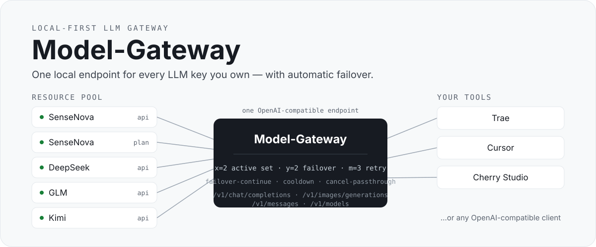

<p align="right"><strong>English</strong> · <a href="./README.zh-CN.md">简体中文</a></p>

<p align="center">
  
</p>

<p align="center">
  
  
  
  
</p>

**Model-Gateway** is a local-first LLM gateway for individual developers. It pools every provider key you own — multiple vendors, multiple accounts, API keys and subscription plans — behind **one OpenAI-compatible endpoint**, and keeps calls alive with automatic retry, failover and resume.

Point Trae, Cursor, Cherry Studio or any OpenAI-compatible client at `http://127.0.0.1:8300/v1` once. From then on, add, swap or drain provider keys behind the gateway without ever touching your tools again.

## Why

- **Key sprawl.** Every tool × every vendor × every key is another line of config you re-type and re-audit. The gateway is the only endpoint your tools ever see.
- **Single points of failure.** A rate-limited or flaky key usually kills the whole session. Here, failures are classified, retried, and — when a resource is exhausted — the request **switches to another resource and continues** mid-task.
- **Opaque consumption.** Every call lands in a plain-text event log with tokens, latency and cost estimates, surfaced in a built-in dashboard.

## Features

| Area | What you get |
| --- | --- |
| Unified inbound API | `/v1/chat/completions` (streaming + non-streaming), `/v1/images/generations`, `/v1/messages` (native Anthropic, bidirectional conversion), `/v1/models` |
| Outbound adapters | OpenAI-compatible, Anthropic and Gemini protocol families |
| Scheduling | `x`/`y`/`m` concurrency-aware routing (see below) |
| Failover-continue | When retries are exhausted, the same request resumes on the next available resource — tools never see the error as long as one resource works |
| Streaming safety | 15s SSE heartbeat; pre-first-token failures switch invisibly; after partial output, received content and errors are passed through verbatim instead of being swallowed; client cancellations propagate upstream |
| Reasoning params | Three-level merge: request-level > resource-level default > vendor builtin (chat only) |
| Web console | Overview, resources, system models, dashboard, request logs, API access and settings — light / dark / system themes |
| Plain-text data | YAML config, JSONL event streams, no database, no binary blobs |
| Access tokens | Multiple named tokens for `/v1/*`, one per tool, individually revocable |

## How scheduling works

The gateway routes each system model over an ordered pool of resources. Three global knobs control everything:

| Knob | Default | Meaning |
| --- | --- | --- |
| `x` — active set | 2 | At most *x* resources serve traffic at once. Requests go to the resource with the fewest in-flight requests (ties break by priority). A failed member is replaced by the next standby. |
| `y` — fail threshold | 2 | *y* consecutive failures (counted across requests) cool a resource down and trigger an immediate switch. |
| `m` — retry limit | 3 | Up to *m* retries on the same resource per request; exhaustion triggers failover-continue. |

Additional guards: each upstream attempt times out after 60s; failed-switch budgets are capped at 300s per request; cooled resources recover automatically (60s for API mode, aligned to the 5h rolling window for plan mode).

## Quick start

> Requires Python 3.12+.

```bash
git clone https://github.com/<your-username>/model-gateway.git
cd model-gateway
python3 -m venv .venv
source .venv/bin/activate        # Windows: .venv\Scripts\activate
pip install -e .

mkdir -p data
cp config.example.yaml data/config.yaml
# edit data/config.yaml: add one provider key to get started

python -m model_gateway.main
```

The web console opens at `http://127.0.0.1:8300`. Create an access token on the **API Access** page (or keep the sample one), then:

```bash
curl http://127.0.0.1:8300/v1/chat/completions \
  -H "Authorization: Bearer mg-xxxxxxxx" \
  -H "Content-Type: application/json" \
  -d '{
    "model": "deepseek-v4-flash",
    "messages": [{"role": "user", "content": "Hello!"}]
  }'
```

To connect a tool, set its OpenAI-compatible base URL to `http://127.0.0.1:8300/v1` and use the access token as the API key. On macOS you can also start the gateway by double-clicking `启动网关.command`.

## Configuration

Everything lives in one plain-text file, `data/config.yaml` (git-ignored). The essentials:

```yaml
scheduling:
  max_active_per_model: 2   # x — active set size
  fail_threshold: 2         # y — consecutive-failure threshold
  retry_per_request: 3      # m — retries per resource per request

resources:                  # one entry per vendor + key
  - id: res-xxxxxxxx        # auto-generated
    name: SenseNova · main
    preset: sensenova-api    # sensenova-api | sensenova-tokenplan | custom
    access_mode: api         # api | plan
    protocol: openai         # openai | anthropic | gemini
    base_url: https://api.sensenova.cn/compatible-mode/v2
    api_key: sk-xxxxxxxx
    enabled: true

models:                      # system models exposed to your tools
  - name: deepseek-v4-flash
    endpoint: chat            # chat | images
    resources:                # ordered = priority
      - resource: res-xxxxxxxx
        model: deepseek-v4-flash
```

Vendor presets pre-fill protocol and endpoints (SenseNova ships both `api` and `tokenplan` presets); any custom OpenAI-compatible endpoint works with `preset: ""`. See [`config.example.yaml`](./config.example.yaml) for every field.

## Design principles

- **Plaintext everywhere.** Config, model enums, event streams and logs are local, readable files. No database.
- **Purely local.** No telemetry, no remote configuration, no auto-update, no external calls except to the providers you configure.
- **Keys stay on your machine.** Credentials live only in the local config file (git-ignored); they are never hardcoded or sent anywhere else.
- **Single user.** No accounts or login. The admin console is unauthenticated by design — run it on your own machine; `/v1/*` calls are protected by access tokens.

## Status & roadmap

Current version: **v0.1.0** — 199/199 tests passing, verified against live providers.

Planned next:

- [ ] Environment-variable references for keys (`${PROVIDER_API_KEY}`)
- [ ] Plan-quota awareness for subscription resources
- [ ] Native Gemini inbound endpoint

## Development

```bash
pip install -e ".[dev]"
pytest
```

## License

[Apache-2.0](./LICENSE)
