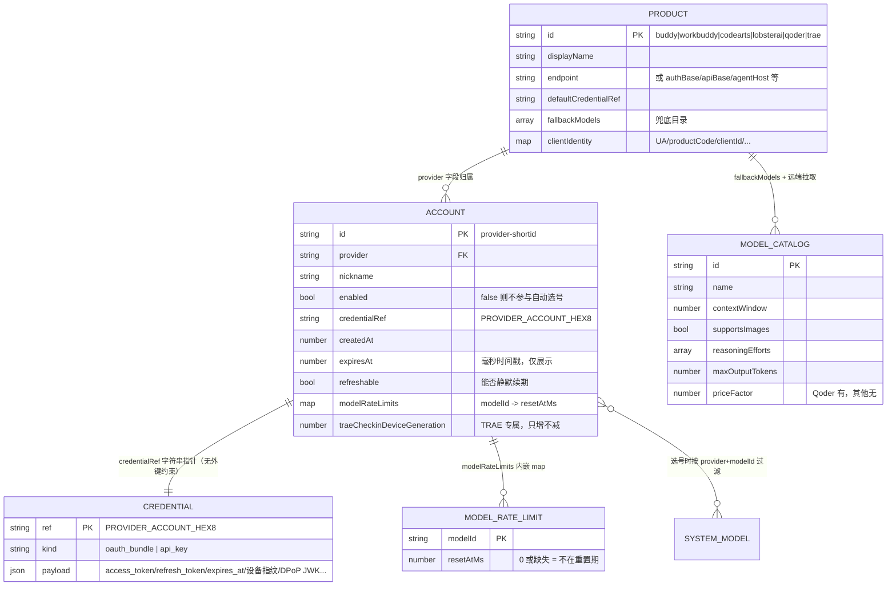

# v2-02 DSH 插件「多产品 × 多账号 → 资源池」机制调研

> 调研对象：`/Users/w/Desktop/AI工作站/05-dsh插件/deepseek-harness-codearts`（简称 DSH 插件）
> 范围：**只覆盖「接入 + 账号池 + 凭据 + 选号」这一半**。模型如何聚合/输出给宿主由另一半负责；涉及边界处仅简述并标注「详见另一半」。
> 约束：参考项目只读；结论以 `src/` 源码为准（不使用 `lib/` 编译产物）；所有结论附 `文件:行号`；推断处显式标注「推断」。
> 网关侧对照基准：`model_gateway/config/schemas.py`、`model_gateway/core/resources.py`、`model_gateway/core/errors.py`、`model_gateway/config/loader.py`。

---

## 0. 结论先行

### 0.1 这套机制的真实骨架（五层）

```
产品注册表(Product)      6 个产品：codearts / buddy / workbuddy / lobsterai / qoder / trae
   ↓ 每个产品一个 Auth 服务实例
接入层(Auth)             6 个 *Auth extends Service，各自实现 login/refresh/refreshAll/logout
   ↓ 登录产出「凭据 JSON 字符串」
凭据层(Credentials)      凭据本体 → ctx.credentials（按 ref 名寻址）
                         账号索引   → ctx.settings[jet-hub].accounts[]（存 credentialRef 指针）
   ↓ 账号索引条目
账号池(AccountPool)      getAvailableAccount(provider, modelId, excludeIds) → 第一个可用账号
   ↓ 适配器拿凭据发请求，失败时轮换
请求层(Adapter)          401/403 → refresh 重试一次；限流 → 写 modelRateLimits + 换号（≤3 个）
```

### 0.2 最关键的 3 条机制

**① 产品差异被收敛成「纯数据」，但收敛得不彻底——存在 4 个平行类型而非 1 个通用类型。**
`src/product.ts:74` 定义 `BuddyProduct`（腾讯系）、`src/qoder-product.ts:126` 定义 `QoderProduct`、`src/trae-product.ts:51` 定义 `TraeProduct`、`src/lobsterai-product.ts:136` 定义 `LobsteraiProduct`。四者是**平行接口、字段互不兼容**，共用的是「产品差异收敛到单一真相源」这个**模式**，不是类型。作者在 `qoder-product.ts:4-17`、`trae-product.ts:14-26`、`lobsterai-product.ts:4-20` 三处都写明了「为什么不复用」的理由：`BuddyProduct.id` 是字面量联合 `'buddy' | 'workbuddy'`，加值会牵动 `productById` / `registerBuddyLlm` 一串调用点。**这是最值得抄的架构决策**：宁可为新协议开一个平行类型，也不要把不相关字段硬塞进一个巨型接口。

**② 账号池的选号算法极简，且顺序即优先级——用户拖拽就是调度策略。**
`account-pool.ts:565-625` 的 `getAvailableAccount` 是三步过滤 + 取第一个：
```
filter(provider === p && enabled)                    // account-pool.ts:571
filter(!excludeAccountIds.has(id))                   // account-pool.ts:572
filter(modelId === '' || 无限流 || Date.now() >= resetAt)  // account-pool.ts:573-579
→ candidates[0]（不再排序，数组顺序 = 用户在 Jet Hub 拖拽的顺序） // account-pool.ts:581-590
```
早期版本按「限流重置时间最早到期」排序，`account-pool.ts:583-587` 记录了为什么改掉：那会让手动顺序形同虚设。这个「手动顺序优先、限流豁免」的语义很干净，可以直接照搬。

**③ 凭据与账号索引**分两处存**，靠 `credentialRef` 字符串指针关联。**
- 账号索引（非密）→ `ctx.settings` 的 `jet-hub` namespace：`ProviderAccountEntry[]`（`types.ts:42-75`），落盘到配置文件。
- 凭据本体（密）→ `ctx.credentials`，按 ref 名寻址，命名规则 `${PROVIDER}_ACCOUNT_${8位大写HEX}`（`jet-hub-rpc.ts:616-617`）。

这样做的直接收益：**UI 读账号列表不需要解密凭据**；直接代价：`getAvailableAccount` 必须逐条 `await credentials.resolve()` 才能判断条目是否可用（`account-pool.ts:594-618`），且适配器为了知道「刚才用的是哪个账号」，得拿 token 值反查（`account-pool.ts:417-429`）。

### 0.3 最不能照抄的 1 个坑

**`getAvailableAccount` 没有任何并发租约/in-flight 标记，并发下必然重复选中同一账号。**
全文 grep `lease|reserve|acquire|in_flight|inflight|busy|lock|mutex|pending|round.?robin|cursor` 在 `account-pool.ts` 中**零命中**（已独立复核，见 §5.4）。`getAvailableAccount` 是纯只读函数：过滤 → 遍历解析凭据 → `return { entry, credential }`（`account-pool.ts:594-618`），返回后池里不留任何痕迹。而 `index.ts:164/187/216/246/269/293/313/332/343` 共 9 处在每次请求的 `resolveCredential` 回调里调用它——**N 个并发请求会拿到同一个 `candidates[0]`**。这不是理论风险：`candidates[0]` 由静态顺序决定，`modelId` 传的是空串（`index.ts:164` 等），连模型级限流过滤都不生效，并发时结果完全一致。
反过来看，**我们网关已经有这个能力**：`resources.py:120-144` 的 `pick_and_acquire` 在选路同一同步段完成 `in_flight += 1`（`resources.py:143`），`resources.py:146-148` 的 `release` 对称递减。**这一块我们比它强，必须保留，不要为了「对齐参考实现」而退化成无租约。**

### 0.4 一句话判断

DSH 插件在**「多产品接入的工程化」**上做得比我们深（6 套协议各自跑通、产品差异收敛、错误分类到位）；在**「账号池的并发正确性」**上不如我们（无租约、无幂等持久化、批量续期粗放）。**建议：抄它的产品注册表 + 凭据/账号分离 + 错误分类映射；不抄它的账号池调度器与续期调度器。**

---

## 1. 产品抽象层：产品注册表字段全表

### 1.1 四个平行类型 vs 一个通用类型（结论）

**结论：不存在通用产品抽象。** 存在 **4 个平行接口** + **6 个 provider 实例**（其中 buddy/workbuddy 共用一个接口）。

| 接口 | 定义位置 | 覆盖 provider | 字段数 |
|---|---|---|---|
| `BuddyProduct` | `src/product.ts:74-144` | `buddy`(CodeBuddy中国版)、`workbuddy`(WorkBuddy国际版) | 15 |
| `QoderProduct` | `src/qoder-product.ts:126-205` | `qoder` | 12 |
| `TraeProduct` | `src/trae-product.ts:51-152` | `trae` | 20 |
| `LobsteraiProduct` | `src/lobsterai-product.ts:136-157` | `lobsterai` | 10 |
| （CodeArts 无产品类型） | — | `codearts` | 0 —— 见下 |

**CodeArts 是唯一的例外**：它没有产品配置对象，常量散落在 `src/login.ts:11-16`（`CODEARTS_LOGIN_BASE` / `HUAWEI_AUTH_BASE` / `CREDENTIAL_ENDPOINT` / `PLUGIN_NAME` / `PLUGIN_VERSION`）、`src/oauth.ts:6-16`（`CLIENT_ID` / `REDIRECT_PATH` / `STS_TOKEN_ENDPOINT`）、`src/models.ts:8,16`（两个模型目录端点）。这是**最老的一个 provider**，产品抽象是后来才引入的，CodeArts 没被回迁。**推断**：这是技术债，不是设计选择。

四处的 `productById` 风格查询函数也各自独立：`product.ts:402-404`（`productById`，返回 `BuddyProduct | undefined`）、`qoder-product.ts:340-342`、`lobsterai-product.ts:221-223`；TRAE 没有 `traeProductById`，直接导出常量 `TRAE`（`trae-product.ts:263`）。`qoder-product.ts:334-339` 注释说明了为什么分开：「三者返回**不同类型**，合并会让调用方拿到联合类型后不得不做类型收窄」。

### 1.2 字段语义分组（跨 4 类型的对照）

把所有字段按**语义**归并（这才是我们要抄的东西）：

| 语义组 | BuddyProduct | QoderProduct | TraeProduct | LobsteraiProduct |
|---|---|---|---|---|
| **路由标识** | `id: 'buddy'\|'workbuddy'` (`product.ts:76`) | `id: 'qoder'` (`qoder-product.ts:128`) | `id: 'trae'` (`trae-product.ts:53`) | `id: 'lobsterai'` (`lobsterai-product.ts:138`) |
| **展示名** | `displayName` (`:90`) | `displayName` (`:130`) | `displayName` (`:55`) | `displayName` (`:140`) |
| **端点族** | `endpoint` (`:83`)、`apiDomain` (`:88`) | `authBase` (`:132`)、`openApiBase` (`:134`)、`inferBase` (`:146`)、`encryptedInferBase` (`:154`) | `agentHost` (`:57`)、`ugHost` (`:59`)、`oauthHost` (`:61`)、`consoleHost` (`:63`) | `portalBase` (`:142`)、`apiBase` (`:144`)、`clientVersionApi` (`:146`) |
| **客户端身份** | `platform` (`:78`)、`productCode` (`:92`)、`userAgent` (`:99`)、`attributionName` (`:118`)、`clientVersion` (`:120`)、`cliVersion` (`:122`)、`userAgentByModelFamily` (`:111`) | `clientId` (`:177`)、`testClientId` (`:183`)、`clientMetadata` (`:185`)、`userAgentPrefix` (`:192`) | `clientId` (`:65`)、`appId` (`:67`)、`ideVersion` (`:74`)、`ideVersionCode` (`:76`)、`deviceBrand` (`:78`)、`osVersion` (`:80`)、`pluginVersion` (`:145`)、`userAgent` (`:149`) | `userAgent` (`:150`)、`clientCapabilities` (`:152`)、`fallbackClientVersion` (`:148`) |
| **默认凭据 ref** | `defaultCredentialRef` (`:124`) | `defaultCredentialRef` (`:194`) | `defaultCredentialRef` (`:147`) | `defaultCredentialRef` (`:154`) |
| **兜底模型目录** | `fallbackModels` (`:136`) | `fallbackModels` (`:204`) | `fallbackModels` (`:151`) | `fallbackModels` (`:156`) |
| **协议开关** | `appendSessionParams` (`:141`)、`pluginVersion` (`:143`) | — | `function` (`:87`)、`channels` (`:102`)、`maxMode` (`:125`)、`maxModeModels` (`:132`)、`hideInternalModels` (`:138`, `@deprecated`) | — |
| **输出上限兜底** | 逐条在 `fallbackModels[].maxOutputTokens` (`product.ts:44`) | 逐条在 `fallbackModels[].maxOutputTokens`（无此字段，只有 `contextWindow`） | `fallbackMaxOutputTokens` (`:110`) | 无 |

**注意 TraeProduct 的 `channels` 语义**（`trae-product.ts:88-101`）：它不是「限流策略」，而是**模型可调用性的硬约束**——「模型只在列出它的通道里可调用（发错通道 → 流内 `4001`）」。默认三个通道 `['solo_agent','solo_work_lite','solo_agent_remote']`（`trae-product.ts:223`），可用 `DSH_TRAE_CHANNELS` 覆盖（`trae-product.ts:217-219`）。

### 1.3 四个实例的关键取值（照搬时的默认值参考）

| 字段 | CODEBUDDY | WORKBUDDY | QODER | TRAE | LOBSTERAI |
|---|---|---|---|---|---|
| 定义位置 | `product.ts:256-272` | `product.ts:369-396` | `qoder-product.ts:311-329` | `trae-product.ts:263-286` | `lobsterai-product.ts:199-210` |
| 主端点 | `https://copilot.tencent.com` | `https://www.workbuddy.ai` | `https://openapi.qoder.sh` | `https://trae-api-cn.mchost.guru` | `https://lobsterai-server.youdao.com` |
| platform/客户端标识 | `platform: 'ide'` | `platform: 'workbuddy-ai'` | `clientId: e883ade2-…` | `appId: 6eefa01c-…` | `X-LobsterAI-Client-*` |
| 默认凭据 ref | `BUDDY_ACCESS_TOKEN` | `WORKBUDDY_ACCESS_TOKEN` | `QODER_ACCESS_TOKEN` | `TRAE_ACCESS_TOKEN` | `LOBSTERAI_ACCESS_TOKEN` |
| 兜底模型数 | 16 条 (`product.ts:168-254`) | 24 条 (`product.ts:283-355`) | 17 条 (`qoder-product.ts:261-308`) | 32 条 (`trae-product.ts:169-202`) | 19 条 (`lobsterai-product.ts:171-191`) |

**端点必须随产品切换的实证**（`product.ts:14-18`）：CodeBuddy 与 WorkBuddy 的模型列表**路径与解析完全相同**（`GET /v3/config` → `data.data.models`），差异**只来自 endpoint**——不同区域后端返回不同模型池（中国版含 glm/hy/deepseek，国际版含 claude/gpt/gemini/kimi）。这是「endpoint 不能当全局常量」的直接依据。

**User-Agent 按模型族分档**（`product.ts:101-111`、`resolveUserAgent` 在 `product.ts:416-421`）：国际版对 `gpt-*`/`gemini-*`/`claude-*` 用国际版 UA，对 `glm-*`/`hy*`/`kimi-*`/`minimax-*` 用国内版 UA（`product.ts:378-388`）。理由是「腾讯后台的『使用端』列按出站 UA 归因」，UA 错了账单显示 `-`（`product.ts:96-98`）。**这是纯腾讯系特例，我们不需要抄**。

### 1.4 限流策略在产品层的落点

**结论：产品配置对象里没有任何限流字段。** 限流完全落在「账号池的 `modelRateLimits`（账号 × 模型）」+「适配器的 `*_MAX_ROTATE` 常量」两处，不在产品配置里。

| 限流相关常量 | 值 | 位置 |
|---|---|---|
| `TRAE_MAX_ROTATE` | 3 | `trae-adapter.ts:133` |
| `LOBSTERAI_MAX_ROTATE` | 3 | `lobsterai-adapter.ts:90` |
| `TRAE_RATE_LIMIT_FALLBACK_MS` | 3_600_000（1h） | `trae-adapter.ts:130` |
| `LOBSTERAI_RATE_LIMIT_FALLBACK_MS` | 3_600_000（1h） | `lobsterai-adapter.ts:80` |
| Buddy/CodeArts 换号 | 无显式上限，`for(;;)` 直到候选耗尽 | `buddy-adapter.ts:1050`、`llm-adapter.ts:995-1015` |

**注意不一致**：腾讯系是 `for(;;)`（试遍所有候选），TRAE/LobsterAI 是 `≤3`。`lobsterai-adapter.ts:946-955` 解释了为什么减 1：Go 的 `MaxRotate` 循环计数包含首个账号，而适配器在进循环前已经用首个凭据发过一次，不减会变成 4 次。**推断**：腾讯系没设上限是因为候选数通常很少，但账号池很大时一次请求会打出 N 个上游请求——这是个潜在放大风险。

### 1.5 模型列表来源（边界，详见另一半）

三种来源，优先级不同：

1. **远端拉取**（`models.ts:120-165` 的 `fetchCodeArtsRemoteModels` 是 CodeArts 版；`buddy-oauth.ts:348` 的 `fetchModels` 是腾讯系版）。CodeArts 用**两个**端点合并去重：`https://opengw.developer.huaweicloud.com/api/v1/gateway/config`（benefit 模型）+ `https://snap-access.cn-north-4.myhuaweicloud.com/v1/model/builtin`（常规模型），都用华为 AK/SK 签名（`models.ts:131,147`）。
2. **磁盘缓存**：`~/.cache/deveco/codearts_models.json`（`models.ts:19,168-172`），原子写 tmp+rename（`models.ts:175-189`），定时刷新间隔 2 小时（`models.ts:25`）。
3. **兜底静态表**：`product.fallbackModels`。

**目录是账号无关的**（`service.ts:277-280`）：「同一个华为云账号体系下发同一份目录」，所以只取第一个能解析出 AK/SK 的账号拉一次（`service.ts:300-308` 的 `firstUsableCredential`，**刻意不用 `getAvailableAccount`**，因为拉目录既不需要账号启用、也与限流无关）。

**门控**（边界，属「展示」而非「路由」）：`account-pool.ts:744-759` 的 `providerCatalogVisible` —— 某 provider 无已登录账号时返回空目录，让宿主把整个 provider 分组隐藏。判据是「凭据可解析」而非「有条目」（`account-pool.ts:462-477`），因为 `logout()` 只清凭据保留条目。默认开启，`DSH_HIDE_MODELS_WITHOUT_ACCOUNT=0` 关闭（`account-pool.ts:767-771`）。**明确不影响路由**（`account-pool.ts:724-728`）。

---

## 2. 接入（授权登录）：六套协议对照

### 2.1 结论：没有通用抽象，但有统一的「两步式」形状

**登录流程抽象层不存在。** 五个登录入口各自独立实现：

| 登录流程入口 | 位置 | 覆盖 provider |
|---|---|---|
| `runLoginFlow` / `runOAuthFlow` / `startOAuthFlow` | `login.ts:228-241` / `428-437` / `393-420` | codearts |
| `runBuddyLoginFlow` | `buddy-oauth.ts:549` | buddy、workbuddy（**共用**） |
| `runLobsteraiLoginFlow` / `startLobsteraiLoginFlow` | `lobsterai-oauth.ts:326-337` / `232-313` | lobsterai |
| `runQoderLoginFlow` / `startQoderLoginFlow` | `qoder-oauth.ts:244-255` / `205-236` | qoder |
| `runTraeLoginFlow` / `startTraeLoginFlow` | `trae-oauth.ts:542` / `583` | trae |

**但有统一的形状约定**（`Started*LoginFlow`）：每个 `startXLoginFlow` 都返回 `{ loginUrl, result: Promise<XLoginFlowResult>, close(): Promise<void> }`，`close` 幂等。理由在 `login.ts:366-375`、`qoder-oauth.ts:11-17`、`lobsterai-oauth.ts:208-215` 三处重复说明：**浏览器只在用户点击后约 5 秒的 transient activation 窗口内允许 `window.open`**，若把「起服务器 → 开浏览器 → 等授权」做成一次阻塞调用，调用方拿到 URL 时手势已过期，`window.open` 被拦截返回 `null`，前端兜底执行 `window.location.href = loginUrl` 会把**整个设置页**导航走。这是作者踩过的真实缺陷（`service.ts:98-108` 记录了用户报障原话「主页面直接跳转过去了」）。

**Auth 服务层也没有基类。** 6 个 `*Auth extends Service`（cordis 的 `Service`，不是本项目的基类）：
`service.ts:75`(CodeArtsAuth)、`buddy-auth.ts:87`(BuddyAuth，实例化两次)、`lobsterai-auth.ts:137`、`qoder-auth.ts:126`、`trae-auth.ts:120`。
每个都**各自重新实现**了：`scheduler`（`new RefreshScheduler`）、`refreshTokenInvalid`/`lastRefreshError`/`active` 三个私有字段、`markRefreshTokenInvalid`、`status`、`refresh`、`refreshAccountCredential`、`refreshAll`、`logout`、`stop`、`scheduleRefresh`、`checkExpired`。**这是本插件最大的一处重复**（约 6×150 行同构代码），`qoder-auth.ts:1-15` 的模块头承认了这一点：「结构与 `src/lobsterai-auth.ts` / `src/buddy-auth.ts` **刻意保持一致**……复用它可以减少一类『某个 provider 的续期行为与众不同』的意外」——用「刻意保持一致」代替了抽象。

### 2.2 六套协议对照表

| 维度 | codearts | buddy / workbuddy | lobsterai | qoder | trae |
|---|---|---|---|---|---|
| **登录类型** | 本地回调服务器（两种分支） | **external-link 轮询** | 本地回调 + authCode | **PKCE 设备码轮询** | 本地回调（固定端口） |
| **回调地址** | `http://127.0.0.1:{port}/authentication`（旧）/ `/oauth/callback`（新） | 无（服务端 `state`） | `http://127.0.0.1:{port}/auth/callback` | `qoder-app://`（自定义协议，不监听端口） | `http://127.0.0.1:{port}/authorize` |
| **端口策略** | 随机；新流程强制 ≥10000（`login.ts:339,342-364`） | 无 | 随机空闲（`lobsterai-oauth.ts:345-358`） | 无 | **固定 18080**（`trae-oauth.ts:40`），被占则回退随机 |
| **PKCE** | ✓ S256（`oauth.ts:58-62`） | ✗ | ✗（`lobsterai-oauth.ts:19` 明确「没有 PKCE / DPoP」） | ✓（设备码，`qoder-oauth.ts:1`） | ✓（新流程，但**未实现**——见下） |
| **DPoP** | ✓ ES256 P-256（`oauth.ts:65-85`，`signDpopJws` 在 `:74-85`） | ✗ | ✗ | ✗ | ✗ |
| **请求签名** | 华为 SDK-HMAC-SHA256（`sign.ts:28-68`） | ✗（Bearer） | ✗（Bearer） | ✗（Bearer） | ✗（`Cloud-IDE-JWT`） |
| **WASM 参与** | ✗ | ✗ | ✗ | ✓ 仅**模型列表**签名（`qoder-wasm.ts:1-35`） | ✗ |
| **轮询间隔** | 1s，最多 120 次（`login.ts:88,83`） | 1s（`buddy.ts:46`），超时 5min（`buddy.ts:44`） | 无（等回调） | 1s（`qoder.ts:18`），超时 5min（`qoder.ts:16`） | 无（等回调） |
| **登录总超时** | 180s（`login.ts:337`） | 5min（`buddy.ts:44`） | 10min（`lobsterai.ts:52`） | 5min（`qoder.ts:16`） | 10min（`trae.ts:70`） |
| **续期载荷特征** | `refresh_token` + `code_verifier` + DPoP 私钥（`service.ts:188-192`） | `refresh_token`（`X-Refresh-Token` 头，`buddy-oauth.ts:306`） | `refresh_token` + `uuid` + `first_keyfrom` + `latest_keyfrom`（`lobsterai.ts:109-113`） | `refresh_token` + `machine_id`（`qoder-auth.ts:279`） | `RefreshToken`（**轮换**，旧值即刻失效，`trae-auth.ts:10-11`） |
| **持久化的设备指纹** | ✗ | ✗ | `uuid` / `first_keyfrom` | `machine_id` | `machine_id`(32hex) + `device_id`(16位数字) |
| **特殊坑** | 端口必须 ≥10000，否则 portal 拒绝（`login.ts:341`） | `expiresAt` 只返回相对 `expiresIn`，需回退解析 JWT `exp`（`buddy.ts:145-148`） | 版本号从第三方域名动态拉，取不到时用兜底值（`lobsterai-product.ts:88-98`） | prod/non-prod 两个 clientId **极易读反**（`qoder-product.ts:158-176`） | 回调参数名必须是 `auth_callback_url`（`trae-oauth.ts:89-90`）；PKCE 分支**未实现** |

### 2.3 每种协议的实现要点（可照搬的细节）

**codearts —— 双分支本地回调（最复杂）**
- 旧流程（`flow:'ticket'`）：`buildLoginUrl`（`login.ts:25-30`）拼 `doer/redirect` URL 再用华为认证页包裹；回调带 `token` / `access_token` / `authCode` / `fingerprint`（base64 编码的 URL）任一到手即完成（`login.ts:181-200`）；带 `secret` 则转去轮询 ticket 端点（`login.ts:201-213`）。
- 新流程（默认）：`buildOAuthLoginUrl`（`login.ts:262-271`）——注意 `code_challenge_method` 必须是 **`SHA-256`**（非 RFC 标准的 `S256`），`login.ts:265-266` 记录「portal 以此识别 OAuth 授权，错值会回退旧 ticket 流程」；且 **URL 不能带 `auth_callback_url`**（`login.ts:268-269`，「多余的会被 portal 视为异常并回退旧流程」）。
- 回调收到 `code` → `exchangeAuthorizationCode`（`oauth.ts:141-155`）→ 307 重定向到 portal 结果页（`login.ts:320`）；收到 `secret` 则走旧流程轮询（`login.ts:299-312`）。
- `parseCredentialResponse`（`login.ts:33-62`）兼容两种响应形态：`data.credential.{access,secret,securitytoken}` 与 `data.result.{accessKeyId,secretAccessKey,securityToken}`。

**buddy/workbuddy —— external-link 轮询（无本地端口）**
- 三步：`fetchAuthState`（`buddy-oauth.ts:137-167`，`POST /v2/plugin/auth/state?platform=<product.platform>`，**无需认证**）→ 打开 `authUrl` → `loopGetToken`（`buddy-oauth.ts:178-222`，`GET /v2/plugin/auth/token?state=...`，错误码 `11217`=未就绪继续轮询）→ `getAccount`（`buddy-oauth.ts:231-277`，`GET /v2/plugin/login/account?state=...`，错误码 `12151`=未就绪）。
- `decorateLoginUrl`（`buddy-oauth.ts:525-539`）：仅当 `product.appendSessionParams` 为真时追加 `version` 与 `loginSessionId`（随机 UUID）——WorkBuddy 需要，CodeBuddy 不需要。
- 两步式特别之处：`account.create` RPC 先 `fetchAuthState` 拿到 `state`+`authUrl` 返回前端，**后台用同一个 state** 异步跑 `runBuddyLoginFlow`（`jet-hub-rpc.ts:628-665`）。

**lobsterai —— 本地回调 + authCode 换 token**
- 登录 URL 形态照抄 Go：`{portalBase}/portal#/login?source=electron&redirect_uri=...&state=...`（`lobsterai-oauth.ts:104-116`）。注意 `redirect_uri` **必须**是 `http://127.0.0.1:{port}/auth/callback` 形态（`lobsterai-oauth.ts:95-97`），且 hash 段不能用 `URL.searchParams` 构造（`lobsterai-oauth.ts:99-102`）。
- 回调校验 `state` 一致性，不匹配直接 400（`lobsterai-oauth.ts:264-269`）。
- exchange 请求体**必须含 5 字段**：`authCode`/`firstKeyfrom`/`latestKeyfrom`/`uuid`/`version`（`lobsterai-oauth.ts:121-124`），**不需要 `Authorization` 头**（`lobsterai-oauth.ts:126`）。
- 与 Go 版的关键差异（`lobsterai-oauth.ts:4-20`）：Go 是**两个进程 + `/tmp` 状态文件**，本项目收进**单进程内的 Promise**，消除跨进程状态文件、残留文件误判、shell/python3 依赖。

**qoder —— PKCE 设备码轮询（不起端口）**
- `createQoderDeviceSession` → `buildQoderAuthUrl` → 轮询 `GET {openApiBase}/api/v1/deviceToken/poll`（`qoder-oauth.ts:119-164`）。
- **404 表示「用户尚未完成授权」，必须继续轮询**（`qoder-oauth.ts:110-114`）：实测该端点返回 404 `{"errorCode":"NotFound"}`，而任意不存在路径返回 401——说明端点存在且被网关豁免认证，404 是业务层「会话未就绪」。其他非 2xx（5xx）**立即抛错**（`qoder-oauth.ts:142-144`）。
- 网络失败容忍 5 次连续失败（`qoder.ts:20` 的 `QODER_POLL_MAX_FAILURES`）。
- 不起监听端口 → 无端口泄漏与回调伪造问题（`qoder-oauth.ts:9`）。

**trae —— 本地回调（固定端口 18080）**
- 登录 URL 参数**极多**（`trae-oauth.ts:99-128`）：`login_version`/`auth_from=solo`/`login_channel=native_ide`/`plugin_version`/`auth_type=local`/`client_id`/`redirect=0`/`login_trace_id`/`auth_callback_url`/`machine_id`/`device_id`/`x_device_id`/`x_machine_id`/`x_device_brand`/`x_device_type`/`x_os_version`/`x_app_version`/`x_app_type`。`trae-oauth.ts:86-98` 记录了早期只发 5 个参数导致「与真实协议完全不匹配」的缺陷。
- `redirect_uri` 由**我们**构造并随登录 URL 发给服务端，因此**必须等监听成功后才能拼 URL**（`trae-oauth.ts:683-685`），否则端口不一致回调收不到。
- 回调解析（`parseTraeCallbackDetailed`，`trae-oauth.ts:273+`）支持两种形态：老流程直传 `refreshToken`；新流程走 PKCE 带 `code`/`authCodeInfo`。**PKCE 分支未实现**——`trae-oauth.ts:329-335` 明确返回 `reason: '上游返回了 PKCE 授权码（code/authCodeInfo），本实现暂不支持该流程'`。**这是当前最大的单点风险**：上游一旦切到 PKCE，TRAE 登录会整体失效。

**qoder-wasm —— 不是认证，是「模型列表签名」**
`qoder-wasm.ts:1-35`：加载 `src/qoder-auth-wasm.wasm`（298KB，随插件分发），用于**生成加密请求体**走加密推理端点。模块头明确「**不是破解密码学**……等同『用客户端自己的钥匙开自己的锁』」。产品配置里也标注了「**只有模型列表需要 WASM 签名**，不要据此推断其它端点：推理、用户信息、积分余额都只需 Bearer」（`qoder-product.ts:198-203`）。**对我们无参考价值**（我们是网关，不是客户端伪装）。

### 2.4 登录成功后拿到的凭据结构（逐产品字段表）

| 凭据类型 | 定义位置 | 字段 |
|---|---|---|
| `BuddyCredential` | `buddy.ts:97-120` | `access_token`、`refresh_token`、`expires_at?`（原始值，毫秒串或 ISO）、`refresh_expires_at?`、`token_type?`、`scope?`、`domain?`、`user_id?`、`nickname?`、`enterprise_id?`、`account_type?` |
| `QoderCredential` | `qoder.ts:144-164` | `security_oauth_token`、`access_token`、`refresh_token?`、`expire_time?`（**毫秒数**）、`refresh_token_expire_time?`、`machine_id`、`uid?`（加密推理必需）、`nickname?` |
| `TraeCredential` | `trae.ts:89-127` | `access_token`、`refresh_token`、`expires_at?`（**毫秒时间戳字符串**）、`uid`、`nickname?`、`machine_id`、`device_id`、`domain?`、`api_host?`、`enterprise_id?` |
| `LobsteraiCredential` | `lobsterai.ts:79-114` | `access_token`、`refresh_token`（可空串）、`expires_at?`、`uid?`、`user_id?`、`nickname?`、`uuid?`、`first_keyfrom?`、`latest_keyfrom?` |
| `CodeArtsCredential` | `types.ts:333-349` | `access_key_id`、`secret_access_key`、`security_token`、`expires_at`（ISO 串）、`domain_id?`、`user_id?`、`user_name?`、`refresh_token?`、`code_verifier?`、`dpop_private_key_jwk?`、`model_rate_limits?` |

**四条跨产品的设计约定（值得抄）：**

1. **凭据一律 JSON 序列化后存成单个字符串**（`ctx.credentials.set(ref, JSON.stringify(credential))`），而非结构化存储。所有 provider 一致。`CodeArtsCredential.model_rate_limits` 字段（`types.ts:347-348`）注释说明它是「框架层附加的运行时元数据，刷新凭据时需保留」——**这是把运行时状态混进凭据本体的坏味道**，续期时必须手动搬运（`service.ts:198`、`service.ts:236-238`、`qoder-auth.ts` 无此字段）。

2. **过期时间格式统一为「毫秒时间戳字符串」**（`trae.ts:97-99`、`lobsterai.ts:92-94` 都写明「与 `BuddyCredential.expires_at` 的存储约定保持一致，`credentialExpiresAtMs` 一套解析逻辑可通用于两者」）。解析函数兼容三种形态（毫秒数字串 / 秒数字串 / ISO）：`buddy.ts:150-157`、`trae.ts:139-149`；兜底再解析 JWT 的 `exp`（`buddy.ts:145-148`、`trae.ts:137`）。

3. **`undefined` ≠ `0`**：无法解析过期时间时返回 `undefined` 而非 `0`（`qoder.ts:190-192`：「『没有过期时间』与『1970 年过期』是两回事」）。展示层缺失时报 `0`（`qoder-oauth.ts:174-176`）。

4. **设备指纹必须持久化且不能重新生成**：TRAE 的 `machine_id`（`trae.ts:108-112`：「同一账号用不同的 `machine_id` 可能会触发风控或要求重新登录」）、`device_id`（`trae.ts:116-119`）；LobsterAI 的 `uuid`（`lobsterai.ts:104-107`：「它是服务端识别『同一安装』的依据」）；Qoder 的 `machine_id`（续期必带，`qoder-auth.ts:13-14`）。

**没有额度信息进凭据。** 六种凭据结构里**都没有**额度/积分字段——额度是独立的查询接口，见 §6。

### 2.5 多账号怎么落地（关键）

**结论：多账号 = 「一个账号一条 `ProviderAccountEntry` + 一个独立 credential ref」，「同产品加第二个账号」在数据上只体现为「多一条 entry + 多一个 ref」，没有其它区分机制。**

落地链条（以 `account.create` RPC 为例，`jet-hub-rpc.ts:612-795`）：

```
1. 生成 id 与 ref 名
   id  = `${provider}-${shortId()}`                    // jet-hub-rpc.ts:615，shortId = 4 字节随机 hex = 8 字符
   ref = `${provider.toUpperCase()}_ACCOUNT_${shortId().toUpperCase()}`  // jet-hub-rpc.ts:616-617
   ⚠️ id 与 ref 用**两次独立**的 shortId()，两者后缀不相关
2. 立即 addAccount 占位（enabled=true, refreshable=false, 无凭据）  // jet-hub-rpc.ts:638-646
   → 目的：让前端 login.poll 能立即看到该账号
3. 返回 { accountId, loginUrl }，前端 window.open
4. 后台 await 登录流程，成功后：
   ctx.credentials.set(ref, flow.access)               // 凭据写入
   pool.updateAccount(id, { nickname, expiresAt, refreshable })  // 回填真实字段
   失败 → pool.removeAccount(id) 清理幽灵账号            // jet-hub-rpc.ts:663
```

**数据上的区分点只有两个**：
- `ProviderAccountEntry.id`（`types.ts:44`，格式 `{provider}-{shortid}`，如 `codearts-a1b2c3d4`）
- `ProviderAccountEntry.credentialRef`（`types.ts:52`，格式 `{PROVIDER}_ACCOUNT_{8位大写HEX}`，如 `CODEARTS_ACCOUNT_A1B2C3D4`）

**`credentialRef` 有格式约束**：`jet-hub-rpc.ts:285-286` 提到「`credentialRef()` 会对名称做正则校验」，所以名字里不能有任意字符（**推断**：应为 `[A-Z0-9_]+` 类约束，未读到 DSH credentials 包源码，标记为未验证）。

**账号列表是「一个全局数组，靠 provider 字段区分」**（`account-pool.ts:352-356`）：不是「每个产品一个数组」。这带来一个具体的设计约束——拖拽排序时必须**只动本 provider 占用的下标**（`account-pool.ts:396-403`），否则会顺带改变其它 provider 的相对位置（`account-pool.ts:355-360` 明确说这是「跨面板的意外副作用」）。

**同产品第二个账号的边界情况**：
- 昵称默认取凭据里的 `nickname`/`user_name`/`user_id`，缺失时回退为 `accountId`（`jet-hub-rpc.ts:653-659`、`689-697`、`719-725`、`749-755`、`778-784`）。
- **没有同一用户重复登录的去重**。同一账号登录两次会得到两条独立 entry（两个 id、两个 ref），池会把它们当成两个不同账号轮流使用。`trae.ts:102` 注释称 `uid` 是「账号池去重标识」，但**代码里没有实际使用它做去重**（grep 未见）。**这是一个真实缺口。**
- 登录失败清理只在 `Promise.catch` 里做（`jet-hub-rpc.ts:660-664`），**进程崩溃/重启不会清理占位条目**——会留下一条无凭据的幽灵账号。`getAvailableAccount` 会在解析凭据失败时跳过它（`account-pool.ts:602-605`），所以不会导致请求失败，但 UI 上会一直显示一个坏账号。**推断**：这是设计取舍，不是 bug。

**登出与删除的区别**（重要）：
- `logout()` **只清凭据，保留账号条目**（`buddy-auth.ts:346-351`、`qoder-auth.ts:439-444`）。因此模型目录门控的判据必须是「凭据可解析」而非「有条目」（`account-pool.ts:462-477`）。
- `removeAccount(id)` 删条目**并**清凭据（`account-pool.ts:333-341`）。

---

## 3. 凭据存储与续期

### 3.1 存储分层与关联

```
┌─────────────────────────────── ctx.settings (namespace 'jet-hub') ───────┐
│  accounts: ProviderAccountEntry[]      ← 非密，落配置文件                 │
│    { id, provider, nickname, enabled, credentialRef, createdAt,          │
│      expiresAt, refreshable, modelRateLimits, traeCheckinDeviceGeneration }│
│  disabledModels: Record<provider, Record<modelId, true>>  ← 模型黑名单     │
└───────────────────────────────────────────────────────────────────────────┘
                     │ credentialRef（字符串指针，非外键约束）
                     ▼
┌─────────────────────────────── ctx.credentials ───────────────────────────┐
│  ref 'CODEARTS_ACCOUNT_A1B2C3D4' → '{"access_key_id":"...","refresh_token":"..."}'
│  ref 'BUDDY_ACCOUNT_XXXXXXXX'    → '{"access_token":"...","refresh_token":"..."}'
│  （每个 provider 另有历史单凭据 ref，如 'BUDDY_ACCESS_TOKEN'，pool 模式下不写）
└───────────────────────────────────────────────────────────────────────────┘
```

- 账号索引 schema：`account-pool.ts:64-75`（`jetHubSchema`），用 `Schema.array(Schema.any())` 承接动态结构。注释 `account-pool.ts:49-62` 记录了一个真实崩溃：**必须是 schemastery schema 而非裸函数**，否则 `settings.describe()` 无条件调 `schema.toJSON()` 会抛 `TypeError: registration.schema.toJSON is not a function`，进而让模型设置页、主题设置、sidebar 的 `settings.get`/`shell.get` 全部 500。
- `settings.replace()` 是**整体替换**，所以每次写账号必须**连同黑名单一起写回**（`account-pool.ts:187-189` 与 `account-pool.ts:250-251` 两处对称注释）。这是一个很容易踩的坑。
- 读源是**进程内权威副本**（`account-pool.ts:136` 的 `cache`），不直接依赖 `scope.get()`。理由（`account-pool.ts:128-134`）：settings 的 resolved 快照在 `replace()` 后未必立即更新，若以滞后快照为读源，并发/连续的 `updateModelRateLimit` 会互相覆盖，典型表现是「多个账号触发限流后，settings.yaml 里一条 `modelRateLimits` 都没有」。
- 凭据来源可能有 `env`/`file` 两种：`account-pool.ts:261-263` 调 `ctx.credentials.describe()` 取 `info.source` 回填到 `ProviderAccountStatus.source`（`types.ts:81-82`）。**推断**：DSH 的 credentials 服务支持环境变量与文件两种来源；具体优先级与文件位置未读到（`@deepseek-ai/dsh-credentials` 不在 `node_modules`，无法验证），标记为未验证。

### 3.2 `RefreshScheduler`（`refresh.ts`）—— 单凭据路径的调度器

| 常量 | 值 | 位置 |
|---|---|---|
| `REFRESH_LEAD_MS` | 3_600_000（提前 1 小时） | `refresh.ts:2` |
| `REFRESH_RETRY_MS` | 600_000（普通失败重试 10min） | `refresh.ts:4` |
| `REFRESH_ABNORMAL_NETWORK_RETRY_MS` | 60_000（网络类失败重试 1min） | `refresh.ts:6` |

调度语义：
- `arm(expiresAtMs)`（`refresh.ts:55-67`）：**先 `generation++`** 再清旧定时器，然后按 `computeFirstRefreshDelayMs` 设置新定时器。`computeFirstRefreshDelayMs`（`refresh.ts:32-40`）：距过期 ≤1h 或无有效过期时间 → 立即（0）；否则触发点 = now + 1h 再叠加 0-59 秒随机偏移（打散同时续期）。
- `stop()`（`refresh.ts:70-77`）：**先 `generation++`** 再清定时器。
- `run()`（`refresh.ts:85-113`）：`pending` 防重入；失败后若 `generation` 已变（说明在途期间被 `stop()`/`arm()` 打断）**直接放弃重试**（`refresh.ts:93-96`）；若是 `RefreshTokenExpiredError`（终态）**不重试**（`refresh.ts:97-100`）；否则按错误类型选重试间隔（`refresh.ts:105`）。`refresh.ts:101-104` 处理了一个细节：在途期间可能已新 `arm()`，需先清掉新定时器再设重试定时器，否则新定时器沦为孤儿。

**登出竞态保护**（`refresh.ts:46-47,71-72` + `buddy-auth.ts:112-113,236`）：`active` 标志 + `generation` 双保险。`logout()` 先置 `active=false` 再清凭据（`buddy-auth.ts:347-350`），在途刷新完成后检查 `if (!this.active) return` 跳过回写（`buddy-auth.ts:236`）。**这套机制是完整且正确的，值得抄。**

### 3.3 续期调度：两套机制并存，且**互相脱节**

**机制 A（每实例一个 `RefreshScheduler`）**：`buddy-auth.ts:98-108`、`qoder-auth.ts:133-143`、`lobsterai-auth.ts:148`、`trae-auth.ts:127`。
**机制 B（全局 30 分钟批量 `refreshAll`）**：`index.ts:357-401`。

```
REFRESH_INTERVAL_MS = 30 * 60 * 1000                     // index.ts:357
refreshAllCredentials() {                                 // index.ts:359-378
  await service.refreshAll(pool)      // codearts          串行
  await buddy.refreshAll(pool)        // buddy
  await workbuddy.refreshAll(pool)    // workbuddy
  await lobsterai.refreshAll(pool)    // lobsterai
  await qoder.refreshAll(pool)        // qoder
  await trae.refreshAll(pool)         // trae
}   // 每个都 try/catch 静默
```

**机制 A 在多账号模式下基本是死代码**（推断，依据如下）：
`scheduleRefresh()` 只解析 `this.credentialRefName`（`buddy-auth.ts:360-368`），而 `credentialRefName = product.defaultCredentialRef`（`buddy-auth.ts:128`），即 `BUDDY_ACCESS_TOKEN` 这类**历史单凭据 ref**。pool 模式下凭据写在 `BUDDY_ACCOUNT_XXX`，`BUDDY_ACCESS_TOKEN` 从未被写入 → `resolve()` 返回 `undefined` → `scheduleRefresh` 提前返回，**永不 arm**。`login()` 调它（`buddy-auth.ts:151`）、`refresh()` 成功后调它（`buddy-auth.ts:240`），都同样落空。**结论：多账号的续期完全依赖机制 B 的 30 分钟批量。** 这一点 `service.ts:259-263` 的注释也间接承认了：「单凭据模式移除后这里不再需要停调度器——登录态与续期都归属账号池条目，续期由 `src/index.ts` 的多账号调度器驱动」。

**`refreshAll` 的三个行为特征**（逐产品核对，语义一致）：
1. **无条件刷新，不检查过期时间**。`buddy-auth.ts:308-343` / `service.ts:211-257` / `qoder-auth.ts:393-436` / `trae-auth.ts:385-` / `lobsterai-auth.ts:473-` 的循环体里**只有 `if (!entry.refreshable) continue`**，没有任何 `expiresAt` 判断。→ **每个可续期账号每 30 分钟被刷新一次，无论是否临近过期。** 对 TRAE 尤其敏感：它的续期是 ExchangeToken **轮换**，旧 `refresh_token` 即刻失效（`trae-auth.ts:10-11`），即每 30 分钟一次 token 轮换。
2. **包含已停用账号**（只按 `refreshable` 过滤）。`buddy-auth.ts:293-307` 记录了为什么：早期有 `if (!entry.enabled) continue`，于是停用一段时间后 refresh_token 过期，用户重新启用时拿到死凭据；更糟的是停用账号仍参与积分领取，用过期凭据打接口服务端回 HTML 错误页 → 前端报 `Unexpected token '<'`。
3. **单账号失败不影响其他账号**，静默吞掉（`buddy-auth.ts:332-341`）。`qoder-auth.ts:425-432` 是唯一加了 warn 日志的（注释：「静默失败会让账号在 UI 上仍显示『可续期』却永远刷不动，无从排查」）。**其它 5 个 provider 没有这条日志**——不一致。

**失败的持久化后果**：
- 凭据缺失 / 无 `refresh_token` → `updateAccount(id, { refreshable: false })`（`buddy-auth.ts:316-324`）。
- 抛 `RefreshTokenExpiredError` → 同样标记 `refreshable: false`（`buddy-auth.ts:333-339`）。**注意：只是标记不可续期，没有标记 `enabled: false`**——账号仍参与选号，只是会带着过期凭据发请求，靠 401 兜底。
- 其它错误（5xx/429/网络）→ 什么都不做，下个 30 分钟再试。

**定时器的启动条件缺陷**（`index.ts:386-401`）：
```js
pool.listAllAccounts().then(accounts => {
  const hasRefreshable = accounts.some(a => a.refreshable)
  if (hasRefreshable) { setInterval(...) }   // ← 只有启动时存在可续期账号才创建定时器
})
```
**启动时若无任何 `refreshable` 账号，定时器永不创建**；之后新登录的账号（`refreshable: true`）**不会被自动续期**，只能靠适配器 401 时的按需 refresh（`buddy-adapter.ts:1032-1039`）或用户手点「刷新」按钮。**这是一个真实缺陷。**

### 3.4 失效判定：结构化特征，不是异常类型

`refresh.ts:21-25` 的 `isRefreshTokenExpired`：
```js
if (!(error instanceof Error)) return false
if (error.name === 'RefreshTokenExpiredError') return true      // ① 按 name 而非 instanceof
return /refresh[_ ]?token/i.test(error.message)                  // ② 消息正则兜底
```
**为什么不用 `instanceof`**（`refresh.ts:17-19` 注释）：**5 个模块各自导出了同名 `RefreshTokenExpiredError`**（`oauth.ts:88`、`buddy-oauth.ts:332`、`qoder-auth.ts:56`、`lobsterai-auth.ts:65`、`trae-auth.ts:57`），跨模块 identity 不同，用 `instanceof` 会让其中一个 provider 的失效信号穿透为「可重试」而无限重试。`qoder-auth.ts:51-55` 反过来确认了这一点，并要求「必须保证 `name` 恰为 `RefreshTokenExpiredError`」。

**各 provider 的终态判定依据**（全部是结构化特征，非异常类型）：

| provider | 终态判定 | 位置 |
|---|---|---|
| buddy | HTTP 401/403，或 body `code` 为 401/403，或 `message` 含 `expired`/`invalid` | `buddy-oauth.ts:315-323` |
| codearts | `error === 'invalid_grant'`，或 `error_code` 含 `ExpiredRefreshToken` / `InvalidDPoPHeader` | `oauth.ts:127-134` |
| qoder | HTTP 401/403，或 200 但响应缺 token | `qoder-auth.ts:359-361, 377-381` |
| trae | HTTP 401/403，或 `classifyTraeError` 判为 `session-dead`，或 2xx+JSON 但无 accessToken | `trae-auth.ts:370-374` |
| lobsterai | HTTP 401/403，或命中 `session-dead` 标记（`40100`/`40101`/`token rejected`/`refresh token was rejected`） | `lobsterai-errors.ts:66-68` + `lobsterai-auth.ts:362-364` |

**注意 `InvalidDPoPHeader` 被归入终态**（`oauth.ts:124-132`）：注释说明「避免 `error_code` 为 `InvalidDPoPHeader` 时每 10 分钟无限重试」。这个分类略显激进——DPoP 头非法可能是本地时钟偏差导致的，不一定是 refresh_token 失效——但作者的取舍是「宁可让用户重新登录，也不要无限重试」。

**网络类错误的识别**（`refresh.ts:9-12`）：`/fetch failed|ENOTFOUND|ECONNREFUSED|proxy|unresolved host|getaddrinfo/i` → 用更短的重试间隔（1min 而非 10min）。

### 3.5 按账号续期 vs 按默认 ref 续期（一个已修复的真实缺陷）

每个 provider 都有**两个**续期入口：
- `refresh()`：读写**本实例的默认单凭据 ref**（`BUDDY_ACCESS_TOKEN`），**会触碰** `refreshTokenInvalid`/`lastRefreshError`/`scheduler`。
- `refreshAccountCredential(refName)`：读写**指定 ref**（`BUDDY_ACCOUNT_XXX`），**刻意不触碰**那三个状态（`buddy-auth.ts:270-291` 注释：「那些状态属于『单凭据路径』，被多账号操作污染会让 UI 显示错误的失效提示」）。

**为什么必须分开**（`index.ts:256-272`、`index.ts:303-316` 两处同款注释，是本插件最有价值的一处缺陷记录）：
> 「`resolveCredential` 优先从账号池取 `LOBSTERAI_ACCOUNT_XXX` 的凭据，而 `lobsterai.refresh()` 读写的是 `LOBSTERAI_ACCESS_TOKEN`。两者错配的后果是——适配器检测到池凭据过期 → 调 refresh → 成功回写到**另一个** ref → 再 resolve 仍取到那份未更新的过期凭据 → 带着过期 token 发请求 → 401。用户看到的是『刚在 Jet Hub 登录好，却一直认证失败』，而日志里续期全是成功的，极难排查。」

因此 `index.ts` 里所有 provider 的 `refresh` 回调都写成「先 `getAvailableAccount` 拿到 entry，再 `refreshAccountCredential(entry.credentialRef)`」，取不到才回退 `refresh()`（`index.ts:170-173`、`256-272`、`303-316`、`342-346`）；`jet-hub-rpc.ts:862-877` 的 `account.refresh` RPC 也按 `entry.credentialRef` 分派。**这个坑我们必须记住：只要凭据存储是「多 ref 可寻址」，续期就必须按 ref 定向，不能用「全局单例 refresh」。**

---

## 4. 账号池算法（`account-pool.ts` 全文）

### 4.1 注册 / 更新 / 删除

| 操作 | 方法 | 位置 | 要点 |
|---|---|---|---|
| 注册 | `addAccount(entry)` | `:314-317` | 纯 append，**无去重、无 id 冲突检查** |
| 更新 | `updateAccount(id, patch)` | `:320-330` | 白名单字段：`nickname`/`enabled`/`expiresAt`/`refreshable`（`:320-322`）。id 不存在则**抛错** |
| 删除 | `removeAccount(id)` | `:333-341` | 先清凭据（吞异常）再删条目；id 不存在则**静默返回** |
| 重排 | `reorderAccounts(provider, orderedIds)` | `:373-406` | 见下 |
| 清理失配 | `pruneAccountsWithForeignDomain(product)` | `:289-311` | 见 §7.6 |

**`reorderAccounts` 的校验语义**（`:384-394`）：`orderedIds` 必须是该 provider **全部**账号 id 的一个**排列**（集合不可变、顺序可变）。不满足直接抛错而不是「尽力而为」，理由（`:362-368`）：少了某个 id（前端列表过期）→ 若静默忽略，那个账号会莫名掉到末尾；多了未知 id → 前端与服务端状态不一致。两种情况都让用户刷新重试。

**`updateAccount` 的白名单**把 `modelRateLimits` 和 `traeCheckinDeviceGeneration` 排除在外——它们只能通过专用方法改（`:635`、`:681`），这保证了「限流代次只增不减」这类不变式。

### 4.2 选号算法（完整）

```
getAvailableAccount(provider, modelId, excludeAccountIds?)        // :565-625
  ├─ 过滤 1: a.provider === provider && a.enabled                 // :571
  ├─ 过滤 2: !excludeAccountIds?.has(a.id)                        // :572
  ├─ 过滤 3: modelId === ''                                       // :575  → 空串：不过滤，直接通过
  │           || !a.modelRateLimits                               // :576
  │           || a.modelRateLimits[modelId] === undefined         // :577
  │           || === 0                                            // :578
  │           || Date.now() >= resetAt                            // :578
  ├─ candidates.length === 0 → return null                        // :580
  ├─ 不排序，候选顺序 = 用户拖拽顺序（readAccounts().filter 保序）  // :581-590
  └─ for entry of candidates:                                     // :594
       try credentials.resolve(ref)                               // :597
       catch → failures.push(...); continue                       // :598-601
       if (!resolved) → failures.push('凭据未配置'); continue      // :602-605
       try JSON.parse(resolved.value)                             // :607
         → 成功则 return { entry, credential }                     // :613
       catch → failures.push('凭据 JSON 损坏'); continue           // :614-617
     return null（并 warn 列出全部失败原因）                        // :619-624
```

**四个必须注意的语义细节：**

1. **`modelId` 为空串时完全不做模型级限流过滤**（`:575`）。注释解释：调用方（provider 的 `resolveCredential` 入口）此时还不知道要发哪个模型，只能退化为「任取一个启用账号」。而 `enabled` 过滤在任何情况下都生效。
   **后果**：`index.ts:164` 等 9 处调用**全部传空串**（`getAvailableAccount('codearts', '')`），意味着**首次选号永远不看限流状态**——限流过滤只在适配器轮换时（传真实 `options.model`）才生效（`buddy-adapter.ts:1065-1067`、`llm-adapter.ts:1003`、`trae-adapter.ts:939-941`、`lobsterai-adapter.ts:981-983`）。
   **推断**：这是有意为之（凭据解析发生在模型确定之前），但代价是「明明有未限流的账号，首个请求仍可能打到限流账号上，要等第一次 429 才换」。**我们网关不存在这个问题**——`pick_and_acquire(system_model, exclude)` 一开始就知道模型（`resources.py:120`）。

2. **`excludeAccountIds` 是必需的，不是可选优化**（`:553-564`）：调用方在请求级轮换时逐个换号，若不排除刚失败的账号就会原地打转。注释明确：「调用方只能拿到『池认为最优的一个』，无法枚举候选自己去重」。对齐 Go 侧 `PickExcluding(tried)`（`pool.go:131`，`lobsterai-adapter.ts:980` 引用）。

3. **`Date.now()` 直接内联**，没有可注入时钟（`:578`、`:646`、`:655-669`、`:936`、`:974`）。→ 限流过期逻辑不可单测（**推断**：单测需靠 fake timer 或直接改 entry 数据）。

4. **凭据解析失败会逐个 warn**，但只在**第一次成功返回前**收集（`:608-612` 的 warn 在循环内、return 之前），若全部失败则在 `:619-624` 汇总 warn。**注意 `:608` 的 warn 位置有点反直觉**：它在「解析成功」的分支里，打印的是**之前**累积的 failures。逻辑正确但可读性差。

### 4.3 限流标记的写入与清理

| 操作 | 方法 | 位置 | 要点 |
|---|---|---|---|
| 写标记 | `updateModelRateLimit(accountId, modelId, resetAtMs)` | `:635-652` | 在**最新快照**上局部合并后整体写回；账号不存在则 warn 后返回（不抛） |
| 清标记 | `clearModelRateLimits(accountId, modelIds?)` | `:511-541` | `modelIds` 省略时清全部；清空后**删除字段本身**避免空对象噪音（`:532-533`） |
| 清过期 | `sweepExpiredRateLimits()` | `:655-670` | 遍历全部账号删除 `resetAtMs > 0 && Date.now() >= resetAtMs` 的键；**只在实际有变更时才写回**（`:669`） |

**`sweepExpiredRateLimits` 没有调用方**（grep 未见任何调用点）。选号时的 `:578` 已经做了懒判定（`Date.now() >= resetAt`），所以这个清理函数是冗余的——**推断**：它可能是早期实现的残留，或预留给某个未接入的定时任务。

**写标记的并发正确性分析（重要，标注为推断）**：
```js
async updateModelRateLimit(...) {
  const accounts = this.readAccounts()        // ① 返回 this.cache 引用（同步）
  ...
  const next = [...accounts]                  // ② 浅拷贝（同步）
  next[idx] = entry                           // ③ 改副本（同步）
  await this.writeAccounts(next)              // ④
}
async writeAccounts(accounts) {
  this.cache = accounts                       // ⑤ 同步更新进程内副本
  await this.scope.replace({...})             // ⑥ 异步落盘
}
```
从 ① 到 ⑤ **全部同步、无 await**，所以进程内副本是线性一致的（B 读到的必是 A 写后的值）。**但 ⑥ 的落盘顺序无保证**：若 A 的 `replace` 比 B 的晚完成，磁盘上留下的是 A 的版本（缺 B 的更新），重启后 B 的限流标记丢失。**推断**：是否真实存在取决于 `settings.replace()` 内部是否串行化（未读到 DSH settings 包源码，无法验证）。这是一个**应当在我们实现里主动规避**的风险点（用串行写队列或 CAS 版本号）。

### 4.4 探活（probe）与重置（reset）的区别

`account-probe.ts:1-30` 的模块头把语义讲得很清楚，两条路径**严格区分**：

| | 重测 retest | 重置 reset |
|---|---|---|
| 网络请求 | **真实发一次最小对话请求** | **不发任何请求** |
| 清除条件 | 只有请求正常完成才清除该模型标记 | 直接清除（`modelIds` 省略 = 全部） |
| 失败处理 | 仍受限/无法确认 → **保留标记**，回传原因 | 不适用 |
| 入口 | `retestAccount` `:194-226` / `retestAllAccounts` `:234-248` | `resetAccount` `:254-257` / `resetAllAccounts` `:260-272` |
| 用途 | 「标记始终反映最近一次实测结果」 | 「用户已知额度恢复，只想清掉显示」 |

**背景**（`account-probe.ts:4-7`）：账号卡片上的「限额重置」只是**一次 429 事件的快照**——记录的是服务端当时给出的「预计恢复时间」，不是账号此刻的真实可用性。服务端常在重置时间前提前放行，于是出现「显示超额使用但发消息正常回复」。

**三点关键设计（`account-probe.ts:22-30`）：**
1. **不传 `accountPool` 给适配器**（`account-probe.ts:115-117`）。适配器只在拿到 `accountPool` 时才切换账号、写限流标记；探测必须只针对**指定账号**且不能产生副作用，否则「重测 A 账号」会顺带污染其他账号的标记。
2. **停用账号也要能重测**。凭据解析走 `resolveCredentialForAccount`（按 id，**不检查 `enabled`**，`account-pool.ts:494-502`），而非 `getAvailableAccount`。
3. **按产品线选适配器，顺序不能颠倒**（`account-probe.ts:122-130`）：`productById(provider)` → BuddyAdapter；`lobsteraiProductById(provider)` → LobsteraiAdapter；其余 → CodeArtsAdapter。注释记录了历史缺陷：「早期这里只判断 `provider === 'buddy'`，导致 workbuddy 落入 else 分支、用华为云 HMAC 签名去发 WorkBuddy 凭据而必然失败」。

**超时**：单次探测 120 秒硬上限（`account-probe.ts:61` 的 `PROBE_TIMEOUT_MS`），用 `AbortSignal.timeout`。理由（`:53-60`）：CodeArts 适配器排队时会以 10 秒间隔重试 chat 请求、最长 30 分钟（`llm-adapter.ts:245,247` 的 `QUEUE_RETRY_DELAY_MS=10_000` / `QUEUE_MAX_ATTEMPTS=180`），设置页按钮不能等那么久。

**限流判定的双重口径**（`account-probe.ts:95-103`）：先看 `LlmError.code` 是否为 `'RATE_LIMIT'`/`'QUOTA_EXCEEDED'`/`'QUOTA'`，再回退到消息正则 `isRateLimited(message)`。注释说明：「buddy/codearts 用字面量 `'QUOTA_EXCEEDED'`，harness 常量 `QUOTA_EXCEEDED_CODE` 是 `'QUOTA'`——两者都认」。

**重测全量是串行而非并发**（`account-probe.ts:230-233`）：「探测会真实消耗模型额度，并发发起容易触发真正想验证的限流，反而得到假阳性」。这个理由很实在。

### 4.5 ⚠️ 并发租约复核（独立复核，读全文）

**复核方法**：对 `account-pool.ts` 全文（705 行）做大小写不敏感 grep，模式 `lease|reserve|acquire|in_flight|inFlight|inflight|busy|lock|mutex|pending|round.?robin|cursor`。

**复核结果：零命中。**

**结论（确定，非推断）：`AccountPool` 不存在任何并发租约、in-flight 计数、占用标记或轮询游标。**

进一步论证——即使不靠 grep，从数据结构也能确认：
- `AccountPool` 的私有状态只有三个：`scope`（settings 句柄，`:126`）、`cache`（账号数组，`:136`）、`modelCache`（黑名单，`:141`）、`loaded`（布尔，`:143`）。**没有任何计数或时间戳结构。**
- `ProviderAccountEntry`（`types.ts:42-75`）的 10 个字段里**没有** `inFlight` / `leasedUntil` / `lastUsedAt` 之类。
- `getAvailableAccount` 的返回类型是 `{ entry, credential } | null`（`:569`），**没有租约令牌**，也没有配对的 `release()` 方法。

**并发下的实际行为（确定性推演）**：
```
时刻 T0：请求 A 调 getAvailableAccount('qoder', '')
          → 同步过滤得到 candidates = [acc1, acc2, acc3]
          → 进入 for 循环，await credentials.resolve(ref_acc1)   ← 挂起点
时刻 T1：请求 B 调 getAvailableAccount('qoder', '')
          → 同步过滤得到**同样的** candidates（cache 未变）
          → 进入 for 循环，await credentials.resolve(ref_acc1)
时刻 T2：A 的 resolve 完成 → return { acc1, cred1 }
时刻 T3：B 的 resolve 完成 → return { acc1, cred1 }   ← 同一账号
```
由于过滤是同步的、且没有任何写入，**A 与 B 必然拿到同一账号**。这在 Node 单线程模型下是**确定性**的，不是概率问题。

**后果评估**：
- 上游按账号维度限流/计费时，所有并发请求挤在 `candidates[0]` 上，**账号池的「聚合额度」实际上没有聚合**——只有在第一个账号被限流并写入标记之后，后续请求才会落到第二个账号。
- 与 §4.2 细节 1 叠加：首次选号不看模型级限流，进一步放大了这个效应。
- **推断**：作者可能认为「靠 429 → 写标记 → 换号」的反馈环足以自愈。但这个环是**串行**的：第 1 个请求失败后写标记，第 2 个请求才开始用 acc2，第 3 个才用 acc3……并发 N 个请求会经历 N 轮失败。对「聚合多个账号额度」这个目标而言，这是**机制性的不达标**。

**对照我们网关**：`resources.py:120-144` 的 `pick_and_acquire` 是**正确的做法**——
```python
active_set = candidates[:self.x]                        # resources.py:140
best = min(active_set, key=lambda r: r.in_flight)       # resources.py:142 集内在途最少者
best.in_flight += 1                                     # resources.py:143 同一同步段完成
```
配合 `resources.py:5` 的注释「选路与在途 +1 在同一同步段（pick_and_acquire，无 await）」和 `resources.py:146-148` 的 `release`。**这一块我们完全不需要改，只需要保证引入 OAuth 账号后仍然走这条路径。**

---

## 5. 额度 / 积分机制

### 5.1 结论：额度是**独立查询接口**，不参与选号

**没有任何额度信息进入 `ProviderAccountEntry`、`getAvailableAccount` 的过滤条件、或适配器的轮换决策。** 实测依据（grep `from './(credits|trae-credits|lobsterai-credits|qoder-credits|codearts-credits)\.js'` 全部命中）：五个积分模块的**唯一实际消费方是 `jet-hub-rpc.ts`**（`jet-hub-rpc.ts:30,43,48,52,57`，即 RPC/展示层）；其余命中都是积分模块之间的**类型互引**（`lobsterai-credits.ts:33`、`codearts-credits.ts:66`、`trae-credits.ts:49`、`qoder-credits.ts:70` 各自 `import type { CreditBalance, ... } from './credits.js'`）。**`account-pool.ts` 与 6 个 `*-adapter.ts` 对积分模块的引用为零。**

**额度与限流的区别**（这才是关键）：
- **额度（credits/积分）**：账号级的余额，**不参与调度**。用户看得到、可以「一键签到领取」，但选号不看它。
- **限流（rate limit）**：账号 × 模型级的重置时间，**参与调度**（`account-pool.ts:573-579` 的过滤 3）。

**推断**：这是有意的——额度是慢变量（日/月周期），限流是快变量（分钟/小时），用额度做调度会引入额外的查询延迟和一致性问题。**但对我们「聚合额度统一输出」的目标来说，这是个缺口**：DSH 并没有真正做到「按剩余额度分配流量」，它只是「把所有账号摆在一起，谁先被限流就换下一个」。

### 5.2 额度建模（两个层级）

**层级 1：`CreditBalance`（跨产品复用的通用模型）** —— `credits.ts:148-167`

```ts
interface CreditBalance {
  total: number            // 当前可用总余额（各有效包的本周期剩余之和）
  packages: CreditPackage[]  // 各资源包明细（含已失效的，由 active 区分）
  expiredTotal: number     // 已失效包里的剩余额度合计（单独给出，不并进 total）
}
```

**层级 2：`CreditPackage`（一个资源包的明细）** —— `credits.ts:120-145`
```ts
{ name, unit, remaining, total, used, active, cycleStartTime, cycleEndTime, expiredTime }
```

**两个最关键的口径结论（`credits.ts:106-118` 的表格）：**
| 字段 | 含义 | 实测（体验版包） |
|---|---|---|
| `CapacityRemain` | 该包的**终身**剩余 | 500 |
| `CycleCapacityRemain` | 该包**本计费周期**剩余 | 0 |

「IDE 顶部的 Credits Balance 用的是**周期口径**。实测该账号终身口径求和为 655.67，而 IDE 显示 155.67——差额 500 正是那个『终身还剩 500、但本周期已一分不剩』的体验版包。**用错字段会让数字凭空多出一大截，且用户无从核对。**」
→ 代码取 `CycleCapacityRemain`（`credits.ts:419`）。

**「失效」的三重判定**（`credits.ts:405-427`）：`Status !== 3`（实测 3 = 已过期）**且** 未过 `ExpiredTime`。失效包仍会出现在 `Accounts[]` 里（额度可能非 0），必须能区分，否则用户以为还能用。未知 `Status` 取值一律当成有效（`credits.ts:390-392`：「宁可多显示一个额度，也不要把能用的额度藏起来」）。

**精确值优先**（`credits.ts:376-384`）：`CapacityRemain`=247（整数截断），`CapacityRemainPrecise`="247.87"（字符串两位小数）。IDE 显示的是后者，故精确值优先、整数版回退。多包相加后按两位小数规整（`credits.ts:488-490` 的 `roundCredits`，导出供 `qoder-credits.ts` 复用，避免各写一份必然分叉）。

**「查不到」与「余额为 0」严格区分**：`fetchCreditBalance` 失败返回 `null`（`credits.ts:443-445`），RPC 层 `RpcCreditsBalanceAccount.balance` 为 `null` 表示查询失败（`types.ts:275-282` 注释：「与『余额为 0』严格区分」）。

### 5.3 各产品的额度接口与能力矩阵

`plugin-src/client/credits-capabilities.js:60-73` 给出**唯一的真相源**（客户端在发请求前门控）。**以代码为准**（下表逐条对照 `:60-73`）：

| provider | balance（余额） | dailyCheckin（签到领取） | 端点 |
|---|---|---|---|
| `codearts` | ✓ | ✓ | 余额 `GET /snap-manager/v1/statistics/plugin`（`codearts-credits.ts:82`）；签到 `/v1/ops/delivery`+`/v1/ops/claim`+`/v1/ops/confirm`（`:84-88`） |
| `buddy` | ✓ | ✓ | 余额 `POST /v2/billing/meter/get-user-resource`（`credits.ts:51`）；签到 `checkin-activity-status`+`daily-checkin`（`credits.ts:33,35`） |
| `workbuddy` | ✓ | **✗** 国际版后端无签到接口 | 余额端点两产品通用（baseURL 随 `product.endpoint` 切换） |
| `lobsterai` | ✓ | ✓ `client-activities` 三步流程 | 余额 `GET /api/user/profile-summary`（`lobsterai-credits.ts:40`）；活动 `/api/client-activities/slot`（`:36`） |
| `qoder` | ✓ | **✓** | 余额 `GET /sash/api/v2/me/usage`（`qoder-credits.ts:75`）；活动 `/sash/api/v1/me/campaigns` → `POST …/{campaignId}/claim`（`:77`） |
| `trae` | ✓ | ✓ | `fetchTraeCreditBalance`（`trae-credits.ts:316`）；签到 `checkin_credits/status` → `checkin_credits/claim`（`credits-capabilities.js:70-71`） |

> **⚠️ 顺带发现一处文档漂移（可作为「注释不可信、必须以代码为准」的例证）**：同一文件顶部的表格（`credits-capabilities.js:22-28`）把 `qoder` 标为「balance ✓ / dailyCheckin **✗ 未见签到接口**」，且**完全没有 `trae` 行**；而实际代码（`:60-73`）里 `qoder` 两项皆为 `true`、`trae` 也在表中。正文注释（`:44-52`）明确写了「`qoder` **两项都有**……早期误判为『两项皆无』」，与顶部表格自相矛盾。**结论：读这个项目的注释时必须回代码核对。**

**能力矩阵的设计理由**（`credits-capabilities.js:3-16` 记录缺陷背景；`:54-56` 给出「默认关闭」原则）：必须在**发起请求之前**判断，因为 Host 侧对三套协议分派，未登记的 provider 会落到 `bad-request`。历史缺陷是「对不支持的 provider 无条件发请求」——每打开一次 CodeArts 面板就产生一条必然失败的报错并把每个账号卡片的积分渲染成「查询失败」。修法是**不发起这个请求**，而不是在 UI 上吞错误。判定一律**默认关闭**（未登记 = 不支持，`:81-92` 的两个门控函数用 `=== true` 而非真值判断），这样将来新增 provider 时忘登记的最坏结果是「暂时看不到积分」，而不是「每次打开面板都发一个必然失败的请求」。**这个「默认关闭 + 集中一张表 + 客户端门控」的模式非常值得抄。**

**两个能力彼此独立，不能互相推断**（`credits-capabilities.js:20` 明确「两个能力**彼此独立，不能互相推断**」，代码上也确实是两个独立字段 `:61-72`）。WorkBuddy 有余额但没签到；Qoder 两项都有但早期被误判为「两项皆无」，原因记在 `credits-capabilities.js:44-52`：「只按 `/api/` 前缀搜索端点，而它挂在 `/sash/` 下」+「`claimable:false` 是当天已领的正常表现」。教训：「某次实测没看到」不能推广成「不存在」。

### 5.4 一个特例：TRAE 的签到设备轮换代次

`types.ts:61-74` 的 `ProviderAccountEntry.traeCheckinDeviceGeneration`：业务码 `9074`（签到人数过多）的限流范围是 **`device_id` 而非账号**。命中后把代次 +1，即可由 `credential.device_id` 派生出一个全新的签到设备号绕开它（`trae.ts` 的 `deriveCheckinDeviceId`）。
**只存整数代次而不存新设备号**，因为派生结果由 `(credential.device_id, generation)` 唯一决定，故无需改写凭据本体（凭据里的 `device_id` 是设备指纹，动它会牵涉风控）。
写入受「只增不减」保护（`account-pool.ts:691-692`：`if (generation <= current) return`），防止乱序/重复回调把代次写回小值而让同一个被限流的设备号复活。
**这是账号池里唯一一个「与限流无关的 per-account 运行时状态」**——说明这个条目的字段设计已经开始膨胀（**推断**：这是设计信号，说明该用「provider 专属扩展字段」而不是不断往通用 entry 上加字段）。

TRAE 签到错误分类自带冷却表（`trae-credits.ts:74-100`）：`1005`→12h、`429`→60s、`401`→永久（`-1`）、`404`→60s、`5xx`→600s、`4xx`→600s、业务码非 0→300s。**注意这套冷却表只用于签到流程，与账号池的 `modelRateLimits` 是两套独立机制**——**推断**：这是 Go 侧移植带来的重复。

---

## 6. 错误分类与限流动作

### 6.1 三套分类器并存

| 分类器 | 位置 | 适用范围 | 类别 |
|---|---|---|---|
| `isRateLimited` + `parseRateLimitError` | `llm-adapter.ts:1510-1512` / `1526-1550` | 腾讯系 + CodeArts（通用） | 布尔 + `{modelId, resetTimeMs}` |
| `classifyTraeError` | `trae-errors.ts:80-126` | TRAE | 8 类 |
| `classifyLobsteraiError` | `lobsterai-errors.ts:100-117` | LobsterAI | 7 类 |

**分类器不统一是个缺陷**：TRAE 与 LobsterAI 有结构化分类（含 `shouldRotate` / `recordsRateLimit` / `isTerminal` 三个策略函数），腾讯系只有「是不是限流」的布尔判断 + 正则抠时间。**推断**：后者是早期实现，前者是后来按 Go 参考实现重写的，没回迁。

### 6.2 `classifyTraeError`（`trae-errors.ts:80-126`）判定顺序

| 序 | 条件 | 类别 | 冷却 |
|---|---|---|---|
| 1 | body 含 `1005` 且含 `plan` | `hard-plan` | 长（12h） |
| 2 | body 含 `4008` / `quota` / `exceeded the quota` | `quota-exceeded` | 长（等每日重置或签到） |
| 3 | body 含 `4011` | `soft-rate` | 短（60s） |
| 4 | HTTP 401 | `session-dead` | 终态，需重新登录 |
| 5 | HTTP 429 | `soft-rate` | 短 |
| 6 | HTTP 404 | `not-found` | 短且不累计 errCount |
| 7 | ≥500 | `server` | — |
| 8 | ≥400 | `client` | — |
| 9 | 否则 | `none` | — |

**「4008 必须排在 4011 之前」**（`trae-errors.ts:92-95`）：两者可能同时出现在一个响应体里（网关把多个错误码拼在 msg 中）。`quota-exceeded` 需长冷却，`soft-rate` 只需短冷却——让较轻的类别抢先命中，会让一个已耗尽额度的账号在 60 秒后被反复重试，用户看到的却是「稍后再试」。**更严重的分类必须优先。**

三个策略函数：
- `shouldRotateTraeAccount(kind)`（`:133-135`）：**除 `none` 外全部换号**（对齐 Go 的每个分支都以 `continue` 结尾）。
- `recordsTraeRateLimit(kind)`（`:148-150`）：只有 `hard-plan` / `soft-rate` / `not-found` / `quota-exceeded` 记限流标记。`session-dead` 与 `server`/`client` **不记**——「它们不是限流」。
- `isTraeTerminalError(kind)`（`:155-157`）：只有 `session-dead`。

### 6.3 `classifyLobsteraiError`（`lobsterai-errors.ts:100-117`）判定顺序

| 序 | 条件 | 类别 | 冷却 |
|---|---|---|---|
| 1 | HTTP **402** | `hard-credit` | 长（12h） |
| 2 | body 含 hard-credit 关键词（中英双通道，`:54-59`） | `hard-credit` | 长 |
| 3 | body 含 `40100`/`40101`/`token rejected`/`refresh token was rejected` | `session-dead` | 终态 |
| 4 | HTTP 429 | `soft-rate` | 短（60s） |
| 5 | HTTP 404 | `not-found` | 短且不累计 errCount |
| 6 | ≥500 | `server` | — |
| 7 | ≥400 | `client` | — |
| 8 | 否则 | `none` | — |

**「body 关键词排在状态码之前（除 402）」**（`lobsterai-errors.ts:89-91`）：实测上游用 **400 + 中文「积分不足」**表达余额耗尽，只按状态码会把这类错误误判成 `client`（可重试），于是反复重试一个永远不会成功的账号。
**中英双通道必需**（`:46-52`）：网易有道系产品同一后端在不同场景返回中文或英文文案，实测两种都出现过。关键词表 `:54-59` 含 11 个英文 + 7 个中文变体（`积分不足`/`额度不足`/`余额不足`/`积分用完`/`额度用尽`/`没有积分`/`积分耗尽`）。
**`session-dead` 排在 429/404 之前**（`:93-95`）：`40100`/`40101` 可能与 4xx 同时出现，会话已死时任何换号重试都没意义。

**「轮转」与「冷却」是两个概念**（`lobsterai-errors.ts:135-137`）：「前者是『这次请求换个人试试』，后者是『把这个账号标记为不可用一段时间』。本插件采纳前者（对齐 Go），不用后者」。这里还纠正了一个历史错误（`:129-133`）：早期实现只对 `hard-credit`/`soft-rate` 换号，并声称「Go 对这种错误也不换号（靠 NoteError 累计 3 次）」——「那是**错的**：`NoteError` 之后紧跟的就是 `continue`，计数只决定『换完之后要不要冷却』，不决定『要不要换』」。

### 6.4 分类后触发的动作（完整链条）

以 Buddy 适配器为例（`buddy-adapter.ts:1040-1085`）：

```
response 非 ok
  ├─ 401/403 且未刷过 → refresh() → resolveCredential() → 重发一次   // :1032-1039
  └─ isRateLimited(errorText) 且 accountPool 存在                     // :1046
       tried = {currentAccountId}                                     // :1047-1048
       for(;;) {
         parsed = parseRateLimitError(errorText, options.model)       // :1051
         if (!parsed) break
         updateModelRateLimit(currentAccountId, parsed.modelId, parsed.resetTimeMs)  // :1054-1058
         next = getAvailableAccount(product.id, options.model, tried)  // :1065-1067
         if (!next || tried.has(next.entry.id)) break                 // :1068
         tried.add(next.entry.id); 换凭据; 重发                        // :1069-1072
         if (ok) { yield* consumeSse; return }                        // :1073-1076
         if (!isRateLimited(errorText)) throw 原错误分类               // :1078-1081
       }
       throw LlmError('所有账号均受限', 'QUOTA_EXCEEDED')             // :1083
```

**三个关键点：**
1. **必须把 `tried` 传给池**（`:1059-1064` 注释）：「池按『重置时间最早到期』排序，刚失败的账号可能仍排第一，不排除就会拿回同一个、命中 `tried.has` 而立即 break」。注意这条注释提到的排序已经不存在了（`account-pool.ts:583-587` 已改为手动顺序），但 `tried` 的必要性依然成立——`candidates[0]` 就是刚失败的那个。
2. **`currentAccountId` 靠 token 值反查**（`buddy-adapter.ts:890-900`）：`findAccountIdByCredential(product.id, credential.access_token)`，实现是遍历所有启用账号、逐个 `resolveCredential` 比对（`account-pool.ts:417-429`）。**这是一次 O(N) 的凭据读取，每个请求一次**——因为 `resolveCredential` 回调只返回凭据、丢掉了 `entry`（`index.ts:184-197`）。**这是一个明确的性能与设计缺陷**：池明明已经知道是哪个账号（`getAvailableAccount` 返回了 `entry`），却在接口边界上把它丢了，迫使适配器反查。
3. **换号不设上限**（`for(;;)`）——见 §1.4。

TRAE / LobsterAI 的结构相同但**多了上限**（`trae-adapter.ts:926-961` 的 `maxRotate = TRAE_MAX_ROTATE - 1 = 2`；`lobsterai-adapter.ts:942-1008` 同构），且**每次轮换重新分类**（`trae-adapter.ts:953`、`lobsterai-adapter.ts:997`），用**本轮**的 kind 决定是否记徽章（`lobsterai-adapter.ts:957-961` 注释：「必须记在**真正失败的那个账号**上——currentAccountId 在下面的循环体里会被推进到下一个账号」）。

**`parseRateLimitError` 的重置时间提取**（`llm-adapter.ts:1523-1544`）：
```js
const RESET_TIME_PATTERN = /(?:将在|reset at)\s+([\d-]+\s+[\d:]+)\s+(UTC[+-]\d+(?::\d+)?)/i
```
兼容中英两种句式并**捕获实际时区**而非硬编码 UTC+8。抠不到时兜底 `Date.now() + 3_600_000`（1 小时）。`llm-adapter.ts:1514-1522` 记录了缺陷：「早期只列了中文句式，导致国际版即使判定为限流也只能走『1 小时后重试』的兜底，丢掉服务端给出的真实重置时刻（UI 限流徽章因此显示错误时间）」。

**`isRateLimited` 的判定**（`llm-adapter.ts:1510-1512`）：`hasRateLimitBusinessCode(body) || RATE_LIMIT_PATTERN.test(body)`。

### 6.5 对我们的映射建议（错误分类部分）

我们网关已有 `ErrorClass` 六类（`errors.py:17-23`）：`RETRYABLE` / `BAD_REQUEST` / `AUTH` / `NOT_FOUND` / `QUOTA` / `CANCELED`。DSH 的类别到我们的映射：

| DSH 类别 | 建议映射 | 需要的额外动作 |
|---|---|---|
| `session-dead`（TRAE/LobsterAI） | `AUTH` | **但语义要扩**：我们现在的 `AUTH` 是「不可重试、透传」；OAuth 账号需要「先 refresh 再重试一次，仍失败则标记账号 `invalid` 并换号」 |
| `hard-plan` / `hard-credit` / `quota-exceeded` | `QUOTA` | 长冷却（DSH 用 12h / 等每日重置）；我们 `cooldown_seconds_plan=18000`（5h，`schemas.py:81`）接近但语义不同 |
| `soft-rate`（429 / 4011） | `QUOTA` | **短冷却**；我们 `cooldown_seconds=60`（`schemas.py:80`）正好对应 |
| `not-found` | `NOT_FOUND` | DSH 对 404 也记短冷却（60s）；我们目前 `NOT_FOUND` 不冷却 |
| `server`（5xx） | `RETRYABLE` | 一致 |
| `client`（其他 4xx） | `BAD_REQUEST` | 一致 |
| `none` | 成功 | — |

**建议新增一个「错误 → 动作」的映射层**，而不是把动作塞进 `ErrorClass`：
```
(ErrorClass, product_id) → {
    rotate: bool,          # 是否换账号
    record_rate_limit: bool,  # 是否写 model_cooldown
    cooldown_seconds: int,
    refresh_and_retry: bool,  # 是否先刷凭据再重试一次
    terminal: bool,        # 是否标记账号需重新登录
}
```
依据：DSH 的三元组（`shouldRotate` / `recordsRateLimit` / `isTerminal`）已经证明「分类」与「动作」必须分离——同一个 `session-dead` 既 `shouldRotate=true` 又 `isTerminal=true`，而 `server` 是 `shouldRotate=true` 但 `recordsRateLimit=false`。**这个三层拆分是本次调研里最值得直接照搬的设计。**

**另外必须加的两条中文关键词**（`lobsterai-errors.ts:54-59` 的直接经验）：国内厂商会用「积分不足 / 额度不足 / 余额不足 / 积分用完 / 额度用尽 / 没有积分 / 积分耗尽」在 400 上表达额度耗尽。只按 HTTP 状态码会把这类错误误判成 `BAD_REQUEST`（可重试），**反复重试一个永远不会成功的账号**。

---

## 7. 数据模型汇总与实体关系

### 7.1 实体关系图



### 7.2 每个实体的类型定义位置

| 实体 | 类型定义 | 存储位置 | 序列化形态 |
|---|---|---|---|
| 产品配置（腾讯系） | `BuddyProduct` `product.ts:74-144` | 源码常量 | 编译期字面量 |
| 产品配置（Qoder） | `QoderProduct` `qoder-product.ts:126-205` | 源码常量 | 同上 |
| 产品配置（TRAE） | `TraeProduct` `trae-product.ts:51-152` | 源码常量 | 同上 |
| 产品配置（LobsterAI） | `LobsteraiProduct` `lobsterai-product.ts:136-157` | 源码常量 | 同上 |
| 产品配置（CodeArts） | **无类型**，常量散落 `login.ts:11-16`/`oauth.ts:6-16`/`models.ts:8,16` | 源码常量 | — |
| 账号索引条目 | `ProviderAccountEntry` `types.ts:42-75` | `ctx.settings['jet-hub'].accounts[]` | 配置文件（明文 YAML/JSON） |
| 账号展示态 | `ProviderAccountStatus extends ProviderAccountEntry` `types.ts:78-83` | 派生（含 `refreshError`/`source`） | 不落盘 |
| 账号池配置根 | `JetHubConfig` `types.ts:86-94` | 同账号索引 | 明文 |
| 模型黑名单 | `ModelDisableMap = Record<string, Record<string, boolean>>` `account-pool.ts:28` | `ctx.settings['jet-hub'].disabledModels` | 明文 |
| 凭据（CodeBuddy 系） | `BuddyCredential` `buddy.ts:97-120` | `ctx.credentials` | **JSON 字符串** |
| 凭据（Qoder） | `QoderCredential` `qoder.ts:144-164` | 同上 | 同上 |
| 凭据（TRAE） | `TraeCredential` `trae.ts:89-127` | 同上 | 同上 |
| 凭据（LobsterAI） | `LobsteraiCredential` `lobsterai.ts:79-114` | 同上 | 同上 |
| 凭据（CodeArts） | `CodeArtsCredential` `types.ts:333-349` | 同上 | 同上 |
| 限流状态 | `RateLimitInfo` `types.ts:34-39`（独立类型，未实际用于存储）；实际存储是 `ProviderAccountEntry.modelRateLimits: Record<string, number>` `types.ts:60` | 账号条目内嵌 | 明文 |
| 探活结果 | `ProbeAccountResult` `types.ts:166-177` / `ProbeModelResult` `types.ts:158-163` | 纯 RPC 响应 | 不落盘 |
| 额度余额 | `CreditBalance` `credits.ts:148-167` / `CreditPackage` `credits.ts:120-145` | 纯查询，**不落盘** | — |
| 签到状态 | `CheckinStatus` `credits.ts:64-87` | 纯查询，**不落盘** | — |

### 7.3 状态机（账号 + 限流）

**账号级状态**（由 `enabled` / `refreshable` / 凭据可解析性三个正交维度决定，**不是一个状态机**）：
```
enabled=true/false            ← 用户手工（account.update RPC）
refreshable=true/false        ← 登录结果 + 续期结果（refreshAll 会把它降为 false）
凭据可解析/不可解析/损坏        ← 凭据存储的真实状态（不落盘，每次现查）
```
`getAvailableAccount` 的判据是「enabled=true **且** 凭据可解析」。`refreshable=false` **不影响选号**（会带着过期凭据发请求，靠 401 兜底）。

**限流级状态**（账号 × 模型，`modelRateLimits[modelId] = resetAtMs`）：
```
无限流标记  ──[429/限流错误]──▶  resetAtMs = 服务端声明时刻（或 now+1h 兜底）
            ◀──[now >= resetAtMs]──  自动恢复（懒判定，account-pool.ts:578）
            ◀──[retest 实测通过]────  主动恢复（account-probe.ts:222-224）
            ◀──[reset 手工清除]────  强制恢复（account-probe.ts:254-257）
            ◀──[sweepExpiredRateLimits]── 批量清理（无调用方）
```

### 7.4 值得注意的「同一个概念有两种表示」

| 概念 | 表示 1 | 表示 2 | 备注 |
|---|---|---|---|
| 凭据 ref | `BUDDY_ACCESS_TOKEN`（单凭据，`buddy-auth.ts:33`） | `BUDDY_ACCOUNT_XXXX`（多账号，`jet-hub-rpc.ts:617`） | 单凭据模式在 CodeArts 已移除（`service.ts:59-69`），但其它 5 个 provider 仍保留 `defaultCredentialRef` 回退路径（`index.ts:190-196` 等） |
| `RefreshTokenExpiredError` | 5 个独立类 | 靠 `error.name` 统一判定（`refresh.ts:23`） | 见 §3.4 |
| 限流 | `modelRateLimits`（账号池，参与调度） | `TraeCheckinError.cooldownSecs`（签到流程，`trae-credits.ts:56-59`） | 两套独立机制 |
| 模型目录 | `product.fallbackModels`（静态） | `models.ts` 内存/磁盘缓存（动态） | 优先级：动态 > 静态 |
| 模型黑名单 | `jet-hub` namespace 的 `disabledModels`（`account-pool.ts:28`） | `JetHubConfig.disabledModels`（`types.ts:93`） | 同一份数据两个类型 |

---

## 8. 对照我们网关的数据模型扩展建议（字段级）

### 8.1 先读我们的现状（基线）

**`model_gateway/config/schemas.py`**：
- `Resource`（`schemas.py:109-129`）：`id` / `name` / `vendor` / `preset` / `access_mode`（`api`|`plan`）/ `protocol`（`openai`|`anthropic`|`gemini`）/ `base_url` / `api_key` / `account` / `enabled`。
  → **`account` 是自由文本**（`schemas.py:128`，注释「账号（资源身份组成，Q20-③ 界面必填）」）；**`api_key` 是明文 YAML**（`schemas.py:127`）。
- `ModelResource`（`schemas.py:132-137`）：`resource`（资源 id）+ `model`（厂商侧模型 id）+ `reasoning`。
- `SystemModel`（`schemas.py:150-191`）：`name` / `group` / `endpoint`（`chat`|`images`）/ `enabled` / `params` / `resources[]`（有序 = 优先级）。
- `GatewayConfig`（`schemas.py:46-65`）、`SchedulingConfig`（`schemas.py:68-81`，x/y/m 全局唯一）。
- `AppConfig`（`schemas.py:206-255`）：`resources[]` 与 `models[].resources[]` 的引用完整性校验在根校验器（`schemas.py:242-253`）。

**`model_gateway/core/resources.py`**：
- `ResourceState`（`resources.py:32-64`）：`rid` / `vendor_model` / `label` / `vendor` / `account` / `status`（`active`|`cooldown`|`disabled`|`invalid`）/ `C`（连续失败计数）/ `cooldown_until` / `last_error` / **`in_flight`** / `enabled` / `access_mode` / `system_models`。
- 注册表键：`(rid, vendor_model)`（`resources.py:70`）——**已是「资源 × 模型」粒度**。
- `pick_and_acquire(system_model, exclude)`（`resources.py:120-144`）：top-x 生效集 + 集内在途最少者 + 同段 `in_flight += 1`。

**我们的三个结构性优势（不要在重构中丢掉）**：
1. **有租约**（`in_flight` + 原子 pick/release）。
2. **冷却是 (资源, 模型) 粒度**（`ResourceState` 按 `(rid, vendor_model)` 建），与 DSH 的 `modelRateLimits` 粒度等价，**不需要改**。
3. **有 `C` 连续失败计数**（`resources.py:162-165` / `:167-168`），DSH 没有。

### 8.2 要新增的实体：`Product`（产品注册表）

**直接借鉴 `product.ts` 的字段分组**，落成 `schemas.py` 的新 model：

```python
class ProductAuthSpec(BaseModel):
    """接入协议规格（决定用哪个登录器与续期器）。"""
    kind: Literal["api_key", "oauth_callback", "oauth_device_code", "oauth_external_link"]
    callback_path: str = ""          # 本地回调路径，如 "/oauth/callback"
    callback_port_min: int = 0       # CodeArts 要求 ≥10000（login.ts:339）
    callback_port_fixed: int = 0     # TRAE 固定 18080（trae-oauth.ts:40）；0 = 随机
    callback_timeout_seconds: int = 300
    poll_interval_seconds: float = 1.0
    poll_max_attempts: int = 120
    uses_pkce: bool = False
    uses_dpop: bool = False
    uses_request_signing: Literal["", "huawei_hmac_sha256"] = ""
    client_id: str = ""
    client_secret_ref: str = ""      # 不存明文，存引用

class Product(BaseModel):
    """产品注册表：一个可被「授权登录」接入的产品。"""
    id: str = Field(min_length=1)              # 'qoder' | 'trae' | ...（= 现有 Resource.vendor 的上位）
    display_name: str = ""
    protocol_family: str = ""                  # 'codebuddy-tencent' | 'huawei' | 'bytedance' | ...
    endpoint: str = ""                         # 主 API 基址
    auth_base: str = ""                        # 登录/OAuth 基址
    api_domain: str = ""                       # 用于 X-Domain 类头
    user_agent: str = ""
    client_version: str = ""
    auth: ProductAuthSpec = Field(default_factory=ProductAuthSpec)
    credential_schema: dict[str, Any] = Field(default_factory=dict)
        # 声明该产品凭据 JSON 的必填字段，用于校验与迁移（对应 §2.4 的字段表）
    fallback_models: list[ProductModel] = Field(default_factory=list)
    capabilities: dict[str, bool] = Field(default_factory=dict)
        # {"balance": True, "daily_checkin": False}（抄 credits-capabilities.js 的「默认关闭」语义）
    extra: dict[str, Any] = Field(default_factory=dict)
        # provider 专属字段（TRAE 的 channels/max_mode、Qoder 的 promotion 等）——
        # 避免像 DSH 那样为每个产品开一个平行接口（product.ts:74 / qoder-product.ts:126 / …）
```

**关键取舍建议**：**不要照抄 DSH 的「四个平行接口」**。它的平行类型是被 TypeScript 字面量联合类型逼出来的（`product.ts:76` 的 `id: 'buddy' | 'workbuddy'`），而 Python + pydantic 用 `extra`/`dict` 承接 provider 专属字段的成本远低于维护四份 schema。**但必须抄它的字段分组方式**（§1.2 那张表）——那才是它的价值。

### 8.3 要新增的实体：`Account` + `Credential`（拆开）

**现状问题**：`Resource` 把「厂商 + 账号 + Key」揉成一个实体（`schemas.py:109-129`）。这在 api_key 场景下没问题，但 OAuth 场景下**撑不住**：
- 一个 OAuth 账号可以服务多个模型（`ModelResource` 已支持），但 `api_key` 是必填（`schemas.py:127`，`min_length=1`）→ 无法表达「这个资源没有 api_key，只有 OAuth 凭据」。
- `account` 是自由文本（`schemas.py:128`）→ 无法做账号级开关、账号级限流、账号级续期状态。

**建议的字段级改动**：

```python
class Credential(BaseModel):
    """凭据本体（**不进 config.yaml**，独立凭据库，权限 0600）。"""
    ref: str = Field(min_length=1)     # 'QODER_ACCOUNT_A1B2C3D4'（对齐 DSH 命名，便于排查）
    product_id: str = ""
    kind: Literal["api_key", "oauth_bundle"] = "api_key"
    payload: dict[str, Any] = Field(default_factory=dict)
    # oauth_bundle 的 payload 字段（按产品）：
    #   通用：access_token, refresh_token, expires_at(ms), refresh_expires_at(ms)
    #   身份：uid, nickname, user_name, domain_id, enterprise_id, account_type
    #   设备指纹：machine_id, device_id, uuid, first_keyfrom, latest_keyfrom
    #   刷新必需：code_verifier, dpop_private_key_jwk
    created_at: int = 0
    updated_at: int = 0

class Account(BaseModel):
    """账号（凭据的持有者，调度的身份单位）。"""
    id: str = Field(min_length=1)              # 'qoder-a1b2c3d4'（对齐 DSH）
    product_id: str = Field(min_length=1)      # FK → Product.id
    credential_ref: str = Field(min_length=1)  # FK → Credential.ref
    nickname: str = ""
    enabled: bool = Field(default=True, strict=True)
    display_order: int = 0                     # 对应 DSH 的数组顺序（拖拽 = 优先级）
    created_at: int = 0
    # 运行时（不落 config.yaml，落状态库，对齐 DSH 的 expiresAt/refreshable）
    expires_at: int | None = None
    refreshable: bool = False
    refresh_error: str = ""                    # 对应 DSH 的 lastRefreshError
    extra: dict[str, Any] = Field(default_factory=dict)   # trae_checkin_device_generation 等
```

**`Resource` 的改动（最小侵入）**：
```python
class Resource(BaseModel):
    id: str = Field(min_length=1)
    name: str = ""
    vendor: str = ""
    preset: str = ""
    access_mode: AccessMode = "api"
    protocol: Protocol = "openai"
    base_url: str = ""

    # ↓ 改动点 1：api_key 与 account 二选一，支持 OAuth
    credential_ref: str = ""        # 新增：指向 Credential.ref（api_key 型也走这里，统一寻址）
    api_key: str = ""               # 保留：向后兼容，min_length 从 1 放宽到 0
    account_id: str = ""            # 新增：FK → Account.id（OAuth 型必填）
    account: str = ""               # 保留：自由文本备注（向后兼容，展示用）

    enabled: bool = Field(default=True, strict=True)

    @model_validator(mode="after")
    def _credential_exclusive(self):
        # 三者必须有其一：credential_ref / api_key / account_id
        if not (self.credential_ref or self.api_key or self.account_id):
            raise ValueError("资源必须提供 credential_ref / api_key / account_id 之一")
        if self.api_key and self.account_id:
            raise ValueError("api_key 与 account_id 互斥（OAuth 账号请用 account_id）")
        return self
```

**兼容性**：现有 `config.yaml` 的 `resources[]` 只填 `api_key`，仍然合法（`api_key` 有值即通过校验）。`schemas.py:242-253` 的引用完整性校验保持不动。

**为什么 `credential_ref` 要同时覆盖 api_key 型**：这样凭据库是**唯一寻址入口**，`ResourceState` 不需要区分「api_key 型」和「OAuth 型」，适配器层拿到的永远是「一个凭据」。这是 DSH `ctx.credentials.resolve(ref)` 的设计价值。

### 8.4 `ResourceState` 的字段扩展

```python
class ResourceState:
    __slots__ = (
        # ... 现有字段保持不变 ...
        "rid", "vendor_model", "label", "vendor", "account", "status", "C",
        "cooldown_until", "last_error", "in_flight", "enabled",
        "access_mode", "system_models",
        # ↓ 新增（OAuth 账号相关）
        "account_id",        # FK → Account.id（空串 = api_key 型）
        "product_id",        # FK → Product.id
        "credential_ref",    # FK → Credential.ref
        "refreshable",       # 能否静默续期（OAuth 型）
        "expires_at",        # 凭据过期时刻（单调时钟无关，用 wall clock）
        "last_refresh_at",   # 上次续期成功时刻
        "refresh_error",     # 上次续期失败原因（供总览展示）
    )
```

**必须新增的一条选路过滤（这是我们当前的真实缺口）**：
```python
def available(self) -> bool:
    # 现有
    if self.status != "active" or not self.enabled:
        return False
    # ↓ 新增：凭据已过期且不可续期 → 不可用（DSH 没有这条，靠 401 兜底）
    if self.expires_at and self.expires_at <= now_ms() and not self.refreshable:
        return False
    return True
```
**依据**：DSH 的 `getAvailableAccount` **完全不看 `expiresAt`**（`account-pool.ts:571-579` 只有 enabled / exclude / modelRateLimits 三个条件），所以它会拿过期凭据去发请求，靠 401 → refresh → 重试兜底（`buddy-adapter.ts:1032-1039`）。多一层预判可以省掉一次必然失败的请求。**但要保留 401 兜底路径**（本地时钟可能不准、服务端可能提前吊销，`llm-adapter.ts:979-981` 记录了这一点：「入口的 `expires_at` 预判无法覆盖后端提前吊销或时钟偏差场景」）。

### 8.5 必须自建的部分（DSH 没有或做得差的）

| 能力 | DSH 的做法 | 为什么不能照抄 | 我们的建议 |
|---|---|---|---|
| **并发租约** | **无**（§4.5 复核：零命中） | 并发下必然重复选中同一账号，与「聚合额度」目标直接冲突 | **保留现有 `in_flight`**（`resources.py:143`）；建议**增加租约 TTL**（`lease_expires_at`），防止请求异常路径漏掉 `release` 导致 `in_flight` 永久泄漏 |
| **幂等持久化** | `read-modify-write` 整个数组 + `settings.replace()`（`account-pool.ts:190-198`），**落盘顺序无保证**（§4.3 推断） | 并发写限流标记可能丢失 | 用**串行写队列**或 **CAS（版本号）**；或把运行时状态（`modelRateLimits`）与配置（账号列表）**分开存**，运行时状态用「追加日志 + 定期压实」而非整体替换 |
| **续期调度** | 全局 30 分钟批量，**无条件刷新所有 `refreshable` 账号**（§3.3），且定时器只在启动时有可续期账号才创建（`index.ts:386-401`） | ① 每 30 分钟无条件刷 token（TRAE 是轮换，代价更高）；② 启动后新登录的账号永不自动续期 | **按 `expires_at` 提前量调度**（抄 DSH `RefreshScheduler` 的 `computeFirstRefreshDelayMs`，`refresh.ts:32-40`，含 0-59s 随机抖动）；定时器**常驻**，不依赖启动快照 |
| **凭据 → 账号的反查** | `findAccountIdByCredential` 靠 token 值 O(N) 遍历（`account-pool.ts:417-429`），因为 `resolveCredential` 回调丢了 `entry`（`index.ts:184-197`） | 每个请求一次 O(N) 凭据读取 | 选路时**直接返回 `(resource_state, credential)` 二元组**，`ResourceState.account_id` 随 `pick_and_acquire` 一起带出，**不做反查** |
| **额度参与调度** | 完全不参与（§5.1） | 与「聚合额度统一输出」的目标不符 | 建议 `Account` 加 `credit_balance: float \| None` + `credit_checked_at: int`，在选路时**作为次级排序键**（同 `in_flight` 时优先余额高的），而不是硬过滤（余额查询有延迟，硬过滤会阻塞选路） |
| **账号去重** | 无（`trae.ts:102` 注释称 `uid` 是去重标识，但代码未使用） | 同一账号重复登录会产生两条独立 entry，被当成两个账号 | 在 `Account` 加 `external_uid: str`（登录时从凭据取），登录完成时按 `(product_id, external_uid)` **幂等 upsert** |
| **登录失败的清理** | 只在 `Promise.catch` 里删占位条目（`jet-hub-rpc.ts:660-664`），**进程崩溃会留幽灵账号** | 需要「启动时清理无凭据的占位条目」 | 登录流程用**状态机持久化**（`pending` → `active`/`failed`），启动时把 `pending` 超时的条目清掉 |

### 8.6 建议的迁移路径（三步，不破坏现有配置）

1. **第一步（无行为变更）**：新增 `Product` / `Account` / `Credential` 三个 model 到 `schemas.py`，`AppConfig` 加三个可选顶层字段（默认空），保持 `resources[]` 语义不变。现有 `config.yaml` 零改动。
2. **第二步（凭据外置）**：`Resource.credential_ref` 落地；`api_key` 放宽为可空；新增凭据库文件（`data/credentials.yaml`，权限 0600）+ 读写 API。迁移脚本把现有 `resources[].api_key` 搬到凭据库并回填 `credential_ref`。
3. **第三步（OAuth 接入）**：`Account` + `Resource.account_id` 落地；实现 `Product.auth` 的三种登录器（`oauth_callback` / `oauth_device_code` / `oauth_external_link`）；`ResourceState` 加 `expires_at`/`refreshable` 并接入 `available()` 过滤；续期调度器按 §8.5 的建议实现。

---

## 9. 缺陷与不可照抄清单

### 9.1 不可照抄（会导致我们退步）

| # | 缺陷 | 位置 | 后果 | 我们的做法 |
|---|---|---|---|---|
| **D1** | **账号池无并发租约** | `account-pool.ts` 全文零命中（§4.5） | 并发请求全部挤在 `candidates[0]`，账号池的额度实际没有聚合 | **保留 `resources.py:143` 的 `in_flight`**；额外加租约 TTL |
| **D2** | **`getAvailableAccount` 用 `Date.now()` 内联，无可注入时钟** | `account-pool.ts:578,646,936,974` | 限流过期逻辑不可单测 | 我们的 `ResourceManager(clock=...)` 已支持注入（`resources.py:68`），保留 |
| **D3** | **账号列表 `read-modify-write` + 整体 `replace`，落盘顺序无保证** | `account-pool.ts:190-198` | 并发写限流标记可能丢失（§4.3 推断） | 串行写队列 / CAS 版本号 |
| **D4** | **`refreshAll` 无条件刷新所有可续期账号** | `buddy-auth.ts:308-343`、`service.ts:211-257`、`qoder-auth.ts:393-436`、`trae-auth.ts:385-` | 每 30 分钟一次 token 轮换（TRAE 代价最高）；`RefreshScheduler` 的精心设计被架空 | 按 `expires_at` 提前量调度 |
| **D5** | **续期定时器只在启动时有可续期账号才创建** | `index.ts:386-401` | 启动后新登录的账号**永不自动续期** | 定时器常驻 |
| **D6** | **首次选号 `modelId` 传空串，不做模型级限流过滤** | `index.ts:164,187,216,246,269,293,313,332,343` + `account-pool.ts:575` | 明明有未限流账号，首个请求仍可能打到限流账号，要等 429 才换 | 我们 `pick_and_acquire(system_model, ...)` 一开始就知道模型（`resources.py:120`），无此问题 |
| **D7** | **`resolveCredential` 回调丢掉 `entry`，迫使适配器 O(N) 反查账号** | `index.ts:184-197` + `buddy-adapter.ts:890-900` + `account-pool.ts:417-429` | 每请求一次 O(N) 凭据读取 | 选路直接返回 `(state, credential)` |
| **D8** | **`RefreshTokenExpiredError` 重复定义 5 次，靠 `error.name` 字符串判定** | `oauth.ts:88`、`buddy-oauth.ts:332`、`qoder-auth.ts:56`、`lobsterai-auth.ts:65`、`trae-auth.ts:57` + `refresh.ts:21-25` | 类型系统失效，重构时容易漏改 `name` | 我们单语言单进程，用一个异常类 |
| **D9** | **6 个 `*Auth` 服务各写一遍 `refresh`/`refreshAll`/`status`/`logout`/`checkExpired`（约 6×150 行同构代码）** | `service.ts:75`、`buddy-auth.ts:87`、`lobsterai-auth.ts:137`、`qoder-auth.ts:126`、`trae-auth.ts:120` | 改一处行为要改 6 处，注释里已出现「刻意保持一致」的自我约束 | 抽一个 `AccountAuthService` 基类，产品差异用 `Product.auth` 数据驱动 |
| **D10** | **CodeArts 没有产品配置对象**，常量散落 3 个文件 | `login.ts:11-16`、`oauth.ts:6-16`、`models.ts:8,16` | 加第 7 个产品时容易漏 | 我们的 `Product` 表从第一天就覆盖全部产品 |
| **D11** | **运行时状态混进凭据本体** | `types.ts:347-348` 的 `CodeArtsCredential.model_rate_limits` | 每次续期都要手动搬运（`service.ts:198,236-238`） | 凭据只放认证材料；限流状态放 `Account`/`ResourceState` |
| **D12** | **账号无去重** | `addAccount` 纯 append（`account-pool.ts:314-317`） | 同一账号重复登录 → 两条 entry，被当成两个账号 | 按 `(product_id, external_uid)` 幂等 upsert |
| **D13** | **登录占位条目在进程崩溃时不会被清理** | `jet-hub-rpc.ts:638-646` + `:660-664` | 留下无凭据的幽灵账号（选路会跳过，但 UI 一直显示） | 登录流程状态机持久化 + 启动清理 |
| **D14** | **`sweepExpiredRateLimits` 无调用方** | `account-pool.ts:655-670` | 死代码 | — |
| **D15** | **TRAE PKCE 登录分支未实现** | `trae-oauth.ts:329-335` | 上游一旦切到 PKCE，TRAE 登录整体失效 | 我们的登录器从一开始就支持 PKCE |
| **D16** | **错误分类器不统一（3 套并存）** | `llm-adapter.ts:1510-1550`（布尔+正则）/ `trae-errors.ts` / `lobsterai-errors.ts` | 行为不一致；腾讯系没有「分类→动作」的三层拆分 | 统一分类器 + 「分类 / 轮转 / 记冷却 / 终态」四个正交策略函数（§6.5） |

### 9.2 可以借鉴但需改进的

| # | DSH 的做法 | 改进点 |
|---|---|---|
| I1 | 「手动顺序 = 优先级，限流豁免」（`account-pool.ts:581-590`） | 直接照搬；额外把 `in_flight` 作为**同顺序下的次级键**（我们的 `resources.py:142` 已有） |
| I2 | `excludeAccountIds`（`tried`）由池层负责排除（`account-pool.ts:553-564`） | 直接照搬——「调用方只能拿到池认为最优的一个，无法枚举候选自己去重」，这个论证是对的 |
| I3 | 探活（真实请求）与重置（纯清除）严格区分（`account-probe.ts:1-30`） | 直接照搬；我们的 `bench`/`note_success` 已有雏形，需要加「实测清除」路径 |
| I4 | 探测时**不传账号池**以避免副作用（`account-probe.ts:115-117`） | 直接照搬 |
| I5 | 全量重测**串行**执行（`account-probe.ts:230-233`） | 直接照搬（理由：并发会触发真正想验证的限流，得假阳性） |
| I6 | 「更严重的错误分类必须优先命中」（`trae-errors.ts:92-95` 的 4008 先于 4011） | 直接照搬；我们的 `ErrorClassifier.classify` 已有优先级顺序（`errors.py:98-127`），需确认同类场景 |
| I7 | 中英双通道关键词表（`lobsterai-errors.ts:54-59`） | **必须照搬**——国内厂商会在 400 上用中文表达额度耗尽 |
| I8 | 「body 关键词优先于 HTTP 状态码」（`lobsterai-errors.ts:89-91`） | 直接照搬 |
| I9 | 「默认关闭」的能力矩阵 + 客户端门控（`credits-capabilities.js:54-56,81-92`） | 直接照搬——未登记 = 不支持，最坏是「看不到」而不是「必然失败」 |
| I10 | 「凭据只存 JSON 字符串，过期时间统一毫秒字符串」（§2.4 约定 1、2） | 照搬；但**用 pydantic model 做校验**，而不是裸 `JSON.parse` |
| I11 | `undefined ≠ 0`（`qoder.ts:190-192`） | 直接照搬——「没有过期时间」与「1970 年过期」是两回事 |
| I12 | 两步式登录（先返回 `loginUrl`，再 await `result`），避免 `window.open` 被拦截 | 照搬形状；我们的网关是 API/CLI 双模式（`docs/research/drafts/04-网关现状与API-CLI双模式调研.md`），CLI 模式可直接阻塞，API 模式需要「返回 URL + 轮询」两个端点 |
| I13 | `RefreshScheduler` 的 `generation` 代号做登出竞态保护（`refresh.ts:46-47,93-96`） | 直接照搬——这是一个干净且正确的模式 |
| I14 | 凭据域名失配时清理账号（`account-pool.ts:289-311`） | **改为告警而非删除**——DSH 是直接 `removeAccount`（`:306`），这是静默数据丢失 |
| I15 | 目录门控「凭据可解析」而非「有条目」（`account-pool.ts:462-477`） | 直接照搬语义 |

### 9.3 补充：DSH 里我**没能验证**但值得警惕的点

1. `settings.replace()` 是否内部串行化（影响 D3 的严重程度）。
2. `ctx.credentials` 的实际存储形态与加密情况（`@deepseek-ai/dsh-credentials` 不在 `node_modules`）。
3. `credentialRef()` 的正则约束具体是什么（`jet-hub-rpc.ts:285-286` 提到有校验但未读到实现）。

---

## 10. 未验证清单

| # | 事项 | 卡点 | 影响 |
|---|---|---|---|
| U1 | `ctx.credentials` 的存储位置、加密方式、`env`/`file` 两种 source 的优先级 | `@deepseek-ai/dsh-credentials` 不在 `node_modules`（`ls node_modules/@deepseek-ai` 为空），无法读到实现；仅从 `account-pool.ts:261-263` 的 `info.source` 用法推断存在两种来源 | 影响 §8.3 凭据库的设计（是否需要加密、是否需要支持 env 来源） |
| U2 | `credentialRef()` 的名称正则约束 | 同上，未读到实现；仅 `jet-hub-rpc.ts:285-286` 提及「会对名称做正则校验」 | 影响我们凭据 ref 的命名规则设计 |
| U3 | `settings.replace()` 是否内部串行化 | 同上，未读到实现 | 决定 D3（并发写丢失）是「真实缺陷」还是「理论风险」。**倾向认为是真实风险**，因为 `account-pool.ts:128-134` 的注释本身就承认了「resolved 快照在 replace() 后未必立即更新」 |
| U4 | 各 provider 的 `resolveCredential` 回调被调用的**确切频率**（每请求一次？每重试一次？） | 只读到 `index.ts` 的回调定义与适配器里的调用点（如 `buddy-adapter.ts:1034`），未穷举全部调用路径 | 影响 D7（O(N) 反查）的性能评估量级 |
| U5 | `trae.ts` 的 `deriveCheckinDeviceId` 具体派生算法 | 未读该函数体（只读了 `types.ts:66-72` 的说明与 `trae.ts:107` 的引用） | 低（签到功能，不在本次范围） |
| U6 | `jet-hub-rpc.ts` 里 `credits.*` RPC 的完整实现 | 只读了模块头与导出列表，未逐行读 | 低（额度不参与调度，属另一半） |
| U7 | 适配器如何把「用了哪个账号」回传给调用方（用于事件/统计） | 未找到回传路径；`ResourceState.account_id` 在 DSH 侧无对应物 | 影响 §8.4 的 `account_id` 是否真的需要放进 `ResourceState` |
| U8 | 上游 `settings.describe()` 的 `redactSecrets` 是否会对账号列表做脱敏 | 只读到 `account-pool.ts:46` 的接口声明与 `index.ts:79` 的调用 | 低 |
| U9 | 该项目 `lib/`（编译产物）与 `src/`（源码）是否存在语义差异 | 本次严格只读 `src/`，未比对 `lib/` | 低（任务要求以 `src/` 为准） |
| U10 | 各 provider 的「限流」是否真的是账号 × 模型粒度（而非账号级或全局） | 从 `modelRateLimits` 的 map 结构与错误文案（含模型名）推断是账号 × 模型；未做实测 | 中（影响我们是否要把冷却粒度从「资源 × 模型」改细） |

---

## 11. 证据附录

### 11.1 本次实际读取的文件清单

**产品配置层**
- `src/product.ts`（422 行，全文）—— `BuddyProduct` `:74-144`、`CODEBUDDY` `:256-272`、`WORKBUDDY` `:369-396`、`ALL_PRODUCTS` `:399`、`productById` `:402-404`、`resolveUserAgent` `:416-421`
- `src/qoder-product.ts`（343 行，全文）—— `QoderProduct` `:126-205`、`QODER` `:311-329`、`qoderProductById` `:340-342`
- `src/trae-product.ts`（287 行，全文）—— `TraeProduct` `:51-152`、`TRAE` `:263-286`
- `src/lobsterai-product.ts`（224 行，全文）—— `LobsteraiProduct` `:136-157`、`LOBSTERAI` `:199-210`

**接入/登录层**
- `src/login.ts`（438 行，全文）—— CodeArts 双分支回调
- `src/oauth.ts`（197 行，全文）—— PKCE / DPoP / STS token
- `src/sign.ts`（69 行，全文）—— 华为 SDK-HMAC-SHA256
- `src/buddy-oauth.ts`（`:130-350` + `:525-560`）—— external-link 轮询、refreshToken、decorateLoginUrl
- `src/lobsterai-oauth.ts`（359 行，全文）—— 本地回调 + authCode
- `src/qoder-oauth.ts`（256 行，全文）—— 设备码轮询
- `src/trae-oauth.ts`（`:99-130`、`:263-335`、`:365-410`、`:512-560`、`:583-720`）—— 回调 + PKCE 分支
- `src/qoder-wasm.ts`（`:1-60`）—— 模块头说明

**认证服务层**
- `src/service.ts`（311 行，全文）—— `CodeArtsAuth`
- `src/buddy-auth.ts`（407 行，全文）—— `BuddyAuth`
- `src/qoder-auth.ts`（482 行，全文）—— `QoderAuth`
- `src/trae-auth.ts`（`:1-80`、`:120-200`、`:277-420`、`:471-543`）—— `TraeAuth`
- `src/lobsterai-auth.ts`（`:137-160`、`:300-420`、`:473-580`）—— `LobsteraiAuth`
- `src/refresh.ts`（115 行，全文）—— `RefreshScheduler`

**账号池层**
- `src/account-pool.ts`（705 行，全文）—— `AccountPool` 全部方法 + `providerCatalogVisible`
- `src/account-probe.ts`（273 行，全文）—— retest / reset
- `src/types.ts`（378 行，全文）—— `ProviderAccountEntry` / `CodeArtsCredential` / RPC 类型

**凭据结构定义**
- `src/buddy.ts:97-157`（`BuddyCredential` / `BuddyToken` / `BuddyAccount` / `credentialExpiresAtMs`）
- `src/qoder.ts:144-203`（`QoderCredential` / `QoderTokenPayload` / `readTimestamp`）
- `src/trae.ts:89-149`（`TraeCredential` / `traeCredentialExpiresAtMs`）
- `src/lobsterai.ts:79-139`（`LobsteraiCredential` / 信封解析）

**额度层**
- `src/credits.ts`（491 行，全文）—— `CreditBalance` / `CreditPackage` / `CheckinStatus`
- `src/trae-credits.ts:50-120`、`:316`（`TraeCheckinError` / `classifyTraeCheckinError`）
- `src/lobsterai-credits.ts`（导出列表 + 端点常量）
- `src/codearts-credits.ts:150-210`（`CodeArtsAccountInfo` / `CodeArtsOpsActivity`）
- `src/qoder-credits.ts`（导出列表 + 端点常量）
- `plugin-src/client/credits-capabilities.js:1-93`（能力矩阵；含 `:22-28` 顶部表格与 `:60-73` 代码表不一致的文档漂移）

**错误分类层**
- `src/trae-errors.ts`（158 行，全文）
- `src/lobsterai-errors.ts`（172 行，全文）
- `src/llm-adapter.ts:955-1045`、`:1510-1550`（限流判定与重置时间提取）

**适配器轮换逻辑（边界）**
- `src/buddy-adapter.ts:884-905`、`:1000-1110`
- `src/lobsterai-adapter.ts:940-1010`
- `src/trae-adapter.ts:890-980`
- `src/llm-adapter.ts:995-1016`

**装配与 RPC**
- `src/index.ts`（431 行，全文）—— 六 provider 注册 + 续期调度器
- `src/jet-hub-rpc.ts:80-140`、`:580-810`、`:840-930`（account.create / refresh / retest / reset）
- `src/models.ts`（224 行，全文）—— CodeArts 模型目录

**网关侧基线**
- `model_gateway/config/schemas.py`（256 行，全文）
- `model_gateway/core/resources.py`（219 行，全文）
- `model_gateway/core/errors.py`（133 行，全文）
- `model_gateway/config/loader.py:1-60`

### 11.2 关键行号速查表

| 结论 | 证据 |
|---|---|
| 产品抽象是 4 个平行接口，无通用类型 | `product.ts:74` / `qoder-product.ts:126` / `trae-product.ts:51` / `lobsterai-product.ts:136`；理由见 `qoder-product.ts:4-17` |
| CodeArts 无产品配置对象 | 常量散落 `login.ts:11-16`、`oauth.ts:6-16`、`models.ts:8,16` |
| 产品注册表字段分组 | `product.ts:74-144`（15 字段）、`qoder-product.ts:126-205`（12）、`trae-product.ts:51-152`（20）、`lobsterai-product.ts:136-157`（10） |
| endpoint 决定模型池 | `product.ts:14-18` |
| 无通用登录抽象，但有统一两步式形状 | 五个 `startXLoginFlow` 返回 `{loginUrl, result, close}`；理由见 `login.ts:366-375` |
| 六套协议差异 | `qoder-product.ts:8-12` 的对照表；各实现见 §2.2 |
| TRAE PKCE 分支未实现 | `trae-oauth.ts:329-335` |
| 凭据结构（5 种） | `buddy.ts:97-120` / `qoder.ts:144-164` / `trae.ts:89-127` / `lobsterai.ts:79-114` / `types.ts:333-349` |
| 凭据与账号索引分离，靠 credentialRef 关联 | `types.ts:52` + `account-pool.ts:261` + `jet-hub-rpc.ts:617` |
| 多账号 = 一条 entry + 一个 ref | `jet-hub-rpc.ts:612-646` |
| 账号 id 与 ref 用两次独立随机 | `jet-hub-rpc.ts:615-617` |
| 账号列表是全局数组，靠 provider 区分 | `account-pool.ts:352-356` |
| 拖拽排序只动本 provider 下标 | `account-pool.ts:396-403` |
| 无账号去重 | `account-pool.ts:314-317`；`trae.ts:102` 注释与实际不符 |
| `settings.replace()` 是整体替换，必须带全字段 | `account-pool.ts:187-189`、`:250-251` |
| schema 必须是 schemastery 否则 describe() 崩 | `account-pool.ts:49-62` |
| 进程内权威副本作为唯一读源 | `account-pool.ts:128-134` |
| `RefreshScheduler` 三常量 | `refresh.ts:2,4,6` |
| `generation` 登出竞态保护 | `refresh.ts:46-47,55-57,70-72,93-96` |
| 终态判定按 `error.name` 而非 `instanceof` | `refresh.ts:17-25` |
| 5 个重复的 `RefreshTokenExpiredError` | `oauth.ts:88` / `buddy-oauth.ts:332` / `qoder-auth.ts:56` / `lobsterai-auth.ts:65` / `trae-auth.ts:57` |
| 续期调度是全局 30 分钟批量 | `index.ts:357-378` |
| `refreshAll` 无条件刷新（不看过期） | `buddy-auth.ts:308-343`（循环体只有 `refreshable` 判断） |
| `refreshAll` 包含停用账号 | `buddy-auth.ts:293-307` 注释 |
| 定时器只在启动时有可续期账号才创建 | `index.ts:386-401` |
| `scheduleRefresh` 只武装默认单凭据 ref | `buddy-auth.ts:128,360-368` |
| 按 ref 续期 vs 按默认 ref 续期的缺陷 | `index.ts:256-272`、`buddy-auth.ts:270-291` |
| 选号三步过滤 + 取第一个 | `account-pool.ts:565-625` |
| `modelId` 空串不过滤限流 | `account-pool.ts:575`；调用点 `index.ts:164` 等 9 处 |
| 手动顺序即优先级（不再排序） | `account-pool.ts:581-590` |
| `excludeAccountIds` 的必要性 | `account-pool.ts:553-564` |
| `Date.now()` 内联，无可注入时钟 | `account-pool.ts:578,646,936,974` |
| `sweepExpiredRateLimits` 无调用方 | `account-pool.ts:655-670`（grep 无调用点） |
| **无并发租约** | `account-pool.ts` 全文 grep `lease\|reserve\|acquire\|in_flight\|lock\|mutex` **零命中** |
| 私有状态只有 4 个（scope/cache/modelCache/loaded） | `account-pool.ts:126,136,141,143` |
| 探活 vs 重置的语义区分 | `account-probe.ts:1-30` |
| 探测不传 accountPool 避免副作用 | `account-probe.ts:115-117` |
| 全量重测串行 | `account-probe.ts:230-233` |
| 探测超时 120s | `account-probe.ts:61` |
| 额度不参与选号 | 全部 `*-credits.ts` 导出符号在 `account-pool.ts`/`*-adapter.ts` 中零引用 |
| 额度取周期口径而非终身口径 | `credits.ts:106-118` 表格 + `credits.ts:419` |
| 失效包判定（Status=3 或过 ExpiredTime） | `credits.ts:390-393,405-427` |
| 精确值优先（`*Precise` 后缀） | `credits.ts:376-384` |
| 能力矩阵「默认关闭」 | `credits-capabilities.js:54-56`（语义）+ `:60-73`（表）+ `:81-92`（两个门控函数） |
| TRAE 签到设备代次只增不减 | `account-pool.ts:691-692`；字段定义 `types.ts:61-74` |
| 错误分类三元组（rotate/record/terminal） | `trae-errors.ts:133-157`、`lobsterai-errors.ts:139-171` |
| 更严重的分类必须优先（4008 先于 4011） | `trae-errors.ts:92-95` |
| body 关键词优先于状态码 | `lobsterai-errors.ts:89-91` |
| 中英双通道关键词 | `lobsterai-errors.ts:46-59` |
| 轮转 vs 冷却是两件事 | `lobsterai-errors.ts:135-137` |
| 换号必须传 `tried` | `buddy-adapter.ts:1059-1068`、`lobsterai-adapter.ts:977-984` |
| `currentAccountId` 靠 token 反查 | `buddy-adapter.ts:890-900` + `account-pool.ts:417-429` |
| 换号无上限（腾讯系）vs 上限 3（TRAE/LobsterAI） | `buddy-adapter.ts:1050` vs `trae-adapter.ts:133`、`lobsterai-adapter.ts:90` |
| 401 后 refresh 重试一次 | `buddy-adapter.ts:1032-1039`、`llm-adapter.ts:982-989` |
| 重置时间正则（中英 + 真实时区） | `llm-adapter.ts:1523` |
| 启动时清理域名失配账号 | `account-pool.ts:289-311` + `index.ts:139-147` |
| **我们已有租约** | `resources.py:120-144`（`in_flight += 1` 在同一同步段）、`resources.py:146-148`（`release`） |
| **我们冷却是 (资源, 模型) 粒度** | `resources.py:70`（`registry: dict[tuple[str,str], ResourceState]`）、`resources.py:90` |
| **我们有连续失败计数 C** | `resources.py:47,162-168` |
| **我们有时钟注入** | `resources.py:68` |
| 我们的 `Resource` 是厂商+账号+Key 扁平模型 | `schemas.py:109-129` |
| 我们的 `api_key` 必填（OAuth 场景撑不住） | `schemas.py:127` |
| 我们的 `account` 是自由文本 | `schemas.py:128` |
| 我们的引用完整性校验 | `schemas.py:242-253` |
| 我们的错误六分类 | `errors.py:17-23` |
| 我们的分类优先级 | `errors.py:98-127` |
| 我们的配置加载/原子写 | `loader.py:32-52`、`loader.py:54+` |

---

*文档结束。另一半（模型聚合与输出）不在本文范围，接口边界见 §1.5、§4.2 细节 1 与 §8.6 第三步。*
